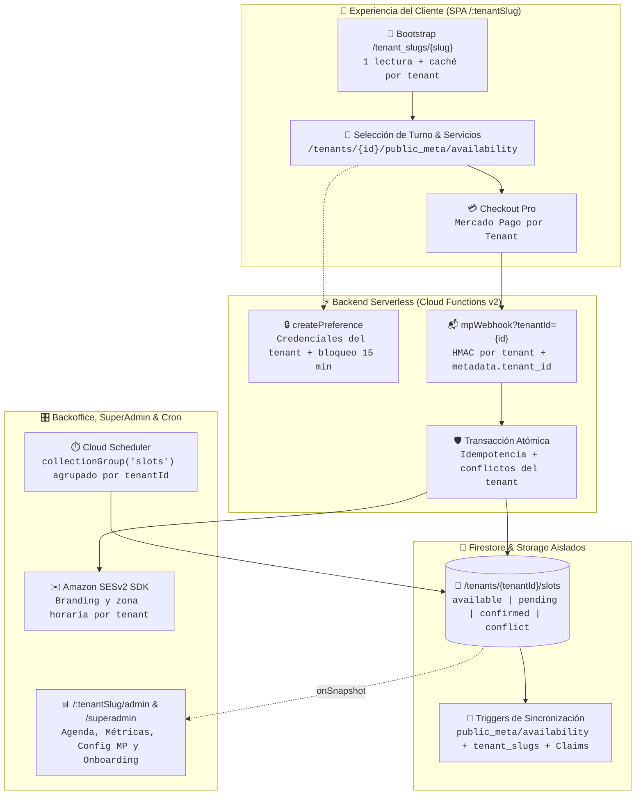

# Turneado Booking System (SaaS Multi-Tenant)

> Plataforma SaaS multi-tenant de gestión de reservas con seña, resolución de conflictos en tiempo real, catálogo de servicios, backoffice aislado por negocio y panel centralizado `/superadmin`.

[](https://react.dev/)
[](https://www.typescriptlang.org/)
[](https://vitejs.dev/)
[](https://reactrouter.com/)
[](https://firebase.google.com/)
[](https://www.mercadopago.com.ar/)

[🌐 Demo en Vivo (`/demo`)](https://turneado.app/)

---

## Arquitectura Multi-Tenant

Turneado opera múltiples negocios independientes sobre un **único proyecto de Firebase** (Hosting, Auth, Firestore, Cloud Functions v2 y Cloud Storage) con aislamiento estricto de datos, archivos, credenciales y permisos:

### Topología de Rutas

```text
/                                  -> Redirección automática a /demo
/superadmin/login                  -> Login exclusivo de administrador de plataforma
/superadmin                        -> Panel de alta, edición, suspensión y cambio de slug (platformAdmin: true)
/:tenantSlug
├── (index)                        -> ClientView (reserva pública de turnos del negocio)
├── /about                         -> Perfil profesional y portfolio del negocio
├── /prices                        -> Catálogo de servicios y precios del negocio
├── /payment/success               -> Retorno Checkout Pro (aprobado)
├── /payment/failure               -> Retorno Checkout Pro (rechazado)
├── /payment/pending               -> Retorno Checkout Pro (pendiente)
├── /login                         -> Login contextualizado al backoffice del negocio
└── /admin                         -> Backoffice del negocio (owner | staff + config MP para owner)
```

### Modelo de Datos y Aislamiento

```text
Firestore:
├── /tenant_slugs/{slug}                      # Bootstrap público en 1 lectura (allow get; allow list: false)
└── /tenants/{tenantId}                       # ID inmutable (/^tnt_[a-z0-9]{4,32}$/)
    ├── /members/{uid}                        # Fuente de verdad -> sincronizada a Custom Claims en Auth
    ├── /private_config/integrations          # Credenciales MP por tenant (solo Admin SDK / Functions)
    ├── /ownerinfo/profile                    # Branding y perfil público del negocio
    ├── /public_meta/availability             # Proyección pública libre de PII (sincronizada por trigger)
    ├── /services/{serviceId}                 # Catálogo de servicios y extras
    ├── /portfolio/{workId}                   # Galería de trabajos
    ├── /slots/{slotId}                       # Turnos completos con PII (mutación exclusiva vía Functions)
    ├── /payment_attempts/{attemptId}         # Intentos de pago con TTL de 30 días (solo backend)
    └── /payment_incidents/{paymentId}        # Alertas de doble pago o pago tardío (lectura owner)

Cloud Storage:
└── /tenants/{tenantId}/{logo|profile|hero|portfolio}/{fileName}
```

### Características Principales

* **Resolución de Tenant sin Enumeración (1 Lectura):** `/tenant_slugs/{slug}` entrega `tenantId`, estado, redirecciones (`redirectToSlug`) y perfil inicial en una sola lectura, bloqueando `list` para evitar enumeración de clientes.
* **Autorización Zero-Trust con Custom Claims + Membresías:** Los roles (`owner`, `staff` por `tenantId`, y `platformAdmin`) se validan en `firestore.rules`, `storage.rules` y Cloud Functions sin lecturas extra en el camino feliz.
* **Mercado Pago por Tenant (Opción A + Fallback `isDemo`):** Cada negocio configura su propio `mpAccessToken` y `mpWebhookSecret` desde `/:tenantSlug/admin` (con webhook dedicado `?tenantId={tenantId}` y verificación HMAC). Solo los tenants marcados explícitamente con `isDemo: true` pueden utilizar el respaldo de variables de entorno globales.
* **Motor de Conflictos y Cron Jobs `collectionGroup`:** Detección automática de solapamientos aislada por `tenantId` y tareas programadas para liberar bloqueos vencidos, reintentar emails y archivar turnos pasados.
* **Panel `/superadmin`:** Alta atómica de negocios, gestión de dueños, cambio de `slug` con redirección automática del slug anterior y suspensión/reactivación.
* **Notificaciones Transaccionales Personalizadas:** Envío de comprobantes y alertas mediante Amazon SES (`@aws-sdk/client-sesv2`) con branding, zona horaria y URLs del negocio correspondiente.

---

## 🔄 Flujo de Datos



---

## Puesta en Marcha

### Requisitos Previos
* **Node.js:** Versión 20+ (24 recomendada para Functions)
* **Gestor de paquetes:** `npm`
* **Firebase CLI:** Instalado globalmente (`npm install -g firebase-tools`) y sesión iniciada (`firebase login`)
* **Cuentas de Servicios:** Proyecto en Firebase (plan Blaze para Cloud Functions salientes), cuenta de Mercado Pago y credenciales IAM de Amazon SES (`turneado.app`)

### Instalación y Ejecución Local

```bash
# 1. Clonar el repositorio
git clone https://github.com/MaximilianoGimenez0/turnos-web.git
cd turnos-web

# 2. Instalar dependencias del cliente y de las funciones
npm install
npm --prefix functions install

# 3. Configurar variables de entorno
cp .env.example .env
cp functions/.env.example functions/.env

# 4. Iniciar el entorno de desarrollo
# Opción recomendada: 100% local con Firebase Emulators (Auth, Firestore, Storage y Functions)
npm run dev:local

# Alternativa: Vite apuntando al proyecto Firebase definido en .env
npm run dev
```

La aplicación quedará disponible en `http://localhost:5173` y redirigirá `/` hacia `/demo`.

> **Modo Emulador Local (`npm run dev:local`):** Compila `functions`, levanta Firebase Emulators con persistencia en `.firebase/emulator-data`, siembra de forma idempotente el usuario SuperAdmin (`admin@local.test` / `LocalAdmin123!`) junto con el negocio `/demo`, y arranca Vite en modo `--mode emulator` (`.env.emulator`). También podés inspeccionar los datos locales en `http://127.0.0.1:4000` o levantar cada parte por separado con `npm run emulators:start`, `npm run emulators:seed` y `npm run dev:emulator`.

### Configuración de Variables de Entorno

* **Frontend (`.env`):** Credenciales públicas del Firebase Web SDK (`VITE_FIREBASE_API_KEY`, `VITE_FIREBASE_AUTH_DOMAIN`, `VITE_FIREBASE_PROJECT_ID`, `VITE_FIREBASE_STORAGE_BUCKET`, `VITE_FIREBASE_MESSAGING_SENDER_ID`, `VITE_FIREBASE_APP_ID`).
* **Backend (`functions/.env`):**
  * `MP_ACCESS_TOKEN` y `MP_WEBHOOK_SECRET`: Credenciales de **respaldo exclusivamente para tenants con `isDemo: true`**. Los negocios comerciales (`isDemo: false`) deben cargar sus propias credenciales desde `/:tenantSlug/admin`.
  * `CLIENT_APP_URL`: URL base del frontend para `back_urls` (`/:tenantSlug/payment/*`) y enlaces al backoffice (`/:tenantSlug/admin`).
  * `MP_WEBHOOK_URL`: URL pública base de la Cloud Function `mpWebhook` (el backend agrega `?tenantId={tenantId}` automáticamente).
  * `AWS_REGION`, `AWS_ACCESS_KEY_ID`, `AWS_SECRET_ACCESS_KEY`, `SES_FROM_EMAIL` (y opcional `SES_CONFIGURATION_SET`): Despacho de comprobantes y alertas de incidentes de pago vía Amazon SES (`@aws-sdk/client-sesv2`).
  * `BUSINESS_NAME`, `BUSINESS_EMAIL`, `BUSINESS_PHONE`: Valores de respaldo usados únicamente en tenants demo si faltan en `ownerinfo/profile`.

---

## Comandos de Operación y Despliegue

### Bootstrap de Administrador de Plataforma (`/superadmin`)

Promueve un usuario existente en Firebase Auth con el Custom Claim `platformAdmin: true` (preservando sus membresías `tenants`):

```bash
npm run admin:bootstrap -- --email admin@tudominio.com
# Para revocar:
npm run admin:bootstrap -- --email admin@tudominio.com --revoke
```

### Secuencia de Despliegue a Producción (Inicio desde Cero)

1. Desplegar índices compuestos y `COLLECTION_GROUP`:
   ```bash
   firebase deploy --only firestore:indexes
   ```
   Aguardar hasta que todos los índices figuren en estado `READY` en Firebase Console.
2. Compilar y desplegar atómicamente Functions, Reglas de Firestore/Storage y Hosting:
   ```bash
   npm run build && firebase deploy --only functions,firestore:rules,storage,hosting
   ```
3. Promover al administrador de plataforma en Firebase Auth:
   ```bash
   npm run admin:bootstrap -- --email <correo>
   ```
4. Ingresar a `/superadmin` para crear el tenant inicial `/demo` (`isDemo: true`) y los negocios productivos, y validar en vivo `/` ($\to$ `/demo`), `/demo/prices`, `/demo/about`, `/demo/login`, `/demo/admin` y `/superadmin`.

---

## Testing y Certificación de Seguridad Cross-Tenant

```bash
# Análisis estático y compilaciones
npm run lint
npm run build
npm --prefix functions run build

# Suite unitaria (frontend y functions)
npm test

# Suite completa de integración + auditoría Cross-Tenant en Firebase Emulators
# (Auth + Firestore + Storage + Functions)
npm run test:integration
```

La suite de integración incluye:
* `tests/integration/crossTenantIsolation.test.ts`: Certificación automatizada de los 6 vectores de intrusión Cross-Tenant (anti-enumeración, lectura/escritura Firestore entre negocios, inmutabilidad de `slots` y blindaje de secretos, aislamiento en Storage, falsificación de `tenantId` en `onCall` y aislamiento de agenda, cron jobs y webhooks MP).

---

## Scripts Disponibles

```bash
# Frontend & Testing
npm run dev                  # Servidor de desarrollo local con Vite (proyecto en .env)
npm run dev:local            # Emuladores Firebase + seed /demo + Vite en modo emulador (todo en 1)
npm run dev:emulator         # Solo Vite apuntando a Firebase Emulators locales (.env.emulator)
npm run emulators:start      # Compila Functions y levanta Firebase Emulators con persistencia local
npm run emulators:seed       # Siembra SuperAdmin (admin@local.test) y /demo en los emuladores
npm run lint                 # Análisis estático con ESLint
npm test                     # Tests unitarios con Vitest
npm run test:integration     # Build de Functions + Emulators + tests de integración y seguridad
npm run build                # Compilación TypeScript y bundle optimizado en dist/
npm run preview              # Previsualización local del build de producción
npm run admin:bootstrap      # Bootstrap de platformAdmin en Firebase Auth

# Functions (dentro de /functions)
npm --prefix functions run build   # Compila TypeScript de Cloud Functions
npm --prefix functions run serve   # Emulador local de Cloud Functions
npm --prefix functions run deploy  # Despliega Cloud Functions
```

---

## Stack Tecnológico

* **Frontend & UI:** React 19, TypeScript ~6.0, Vite 8, React Router v7, Motion, Lucide React, CSS Modules.
* **Backend & Serverless:** Firebase Cloud Functions v2 (Node.js 24), Cloud Scheduler.
* **Base de Datos & Storage:** Cloud Firestore (NoSQL reactivo en tiempo real), Firebase Storage, Firebase Auth (Custom Claims).
* **Pasarela de Pagos & Emails:** Mercado Pago Checkout Pro API (Webhooks IPN + HMAC por tenant), Amazon SES (`@aws-sdk/client-sesv2`).
* **Calidad & Testing:** Vitest 4, Firebase Emulator Suite, ESLint 10, TypeScript-ESLint.
* **Hosting:** Firebase Hosting.

---

## Autor & Contacto

* **Maximiliano Giménez**
* **Portfolio:** [maxigimenez.com.ar](https://maxigimenez.com.ar)
* **GitHub:** [@MaximilianoGimenez0](https://github.com/MaximilianoGimenez0)
* **LinkedIn:** [Maximiliano Giménez](https://www.linkedin.com/in/maximiliano-gim%C3%A9nez-2644b0338/)
