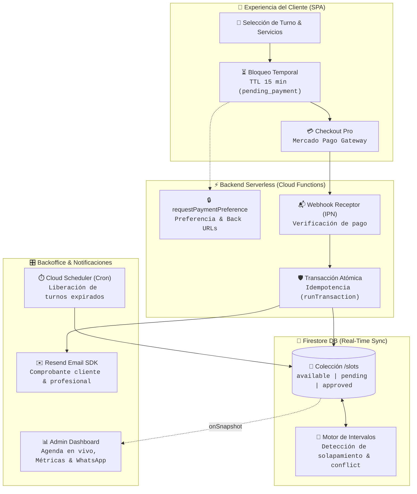

# ⏳ TurnosWeb Booking System

> Sistema de gestión de reservas con seña, resolución de conflictos en tiempo real, catálogo de servicios y backoffice integral para profesionales y estudios de estética.

[](https://react.dev/)
[](https://www.typescriptlang.org/)
[](https://vitejs.dev/)
[](https://reactrouter.com/)
[](https://firebase.google.com/)
[](https://www.mercadopago.com.ar/)

[🌐 Demo en Vivo](https://turnos-web.maxigimenez.com.ar/)

---

## ⚡ Características Principales

* **📅 Sincronización en Tiempo Real:** Disponibilidad y estados de turnos sincronizados al instante mediante listeners reactivos nativos de Firestore (`onSnapshot`).
* **💳 Pasarela de Pagos & Cobro de Seña:** Integración con Mercado Pago Checkout Pro para asegurar turnos con seña y cálculo transparente de saldo pendiente.
* **🛡️ Bloqueo Concurrente y Tolerancia a Fallos:** Reserva de turnos con TTL de 15 minutos y transacciones atómicas para prevenir conflictos.
* **🔀 Motor de resolución de Conflictos:** Detección automática de solapamiento entre duraciones de servicios; los turnos afectados se aíslan en estado `conflict` sin eliminarse y vuelven a liberarse dependiendo de las condiciones y las asignaciones de turnos.
* **🎛️ Panel de Administración (Backoffice):** Dashboard privado para el profesional con agenda en vivo, creación masiva de turnos, asignación forzada y métricas de ingresos.
* **🎨 Catálogo de Servicios & Portfolio:** ABM dinámico de tratamientos, duraciones estimadas, precios y galería de trabajos previos alojada en Firebase Storage.
* **📬 Notificaciones Transaccionales Automatizadas:** Despacho de confirmaciones de pago y avisos por correo electrónico para cliente y profesional mediante Resend.
* **📝 Gestión de Turnos:** Creación, edición y eliminación de turnos por parte del profesional, con validación de disponibilidad y estado de conflictos.
* **📊 Estadísticas del Profesional:** Visualización de ingresos generados por servicios, señas y pagos totales.
* **⏱️ Mantenimiento Desatendido:** Tareas programadas en Cloud Scheduler para liberar reservas impagas vencidas y purgar turnos históricos.

---

## 🔄 Flujo de Datos



---

## 💻 Puesta en Marcha

### Requisitos Previos
* **Node.js:** Versión 20+ (LTS recomendada)
* **Gestor de paquetes:** `npm`, `pnpm` o `yarn`
* **Firebase CLI:** Instalado globalmente (`npm install -g firebase-tools`) y sesión iniciada (`firebase login`)
* **Cuentas de Servicios:** Proyecto en Firebase (plan Blaze requerido para Cloud Functions salientes), cuenta de Mercado Pago y API Key de Resend

### Configuración de Firebase
1. **Authentication:** En la consola de Firebase, habilitar el proveedor **Correo electrónico / Contraseña** y crear el usuario del administrador/dueño para iniciar sesión en `/login`.
2. **Firestore & Storage:** Crear la base de datos Firestore y el bucket de Storage, desplegando las reglas de seguridad con `firebase deploy --only firestore:rules,storage`.
3. **Cloud Functions:** Indispensable para transacciones seguras de reservas, webhooks de pago y notificaciones por correo.

### Instalación y Ejecución

```bash
# 1. Clonar el repositorio
git clone https://github.com/MaximilianoGimenez0/turnos-web.git
cd turnos-web

# 2. Instalar dependencias del cliente y de las funciones
npm install
cd functions && npm install && cd ..

# 3. Configurar variables de entorno
cp .env.example .env
cp functions/.env.example functions/.env

# 4. Iniciar el entorno de desarrollo
npm run dev
```

La aplicación quedará disponible en `http://localhost:5173`.

### Configuración de Variables de Entorno

* **Frontend (`.env`):** Credenciales públicas de Firebase Web SDK (`VITE_FIREBASE_API_KEY`, `VITE_FIREBASE_PROJECT_ID`, etc.).
* **Backend (`functions/.env`):** Credenciales operativas del servidor:
  * `MP_ACCESS_TOKEN`: Token de producción o sandbox de Mercado Pago.
  * `CLIENT_APP_URL`: URL del frontend (ej. `http://localhost:5173`).
  * `RESEND_API_KEY` y `RESEND_FROM_EMAIL`: Para despacho de comprobantes y alertas.
  * `BUSINESS_EMAIL`: Correo del dueño para recibir confirmaciones de reservas.

> [!IMPORTANT]
> **Dependencia Crítica de Cloud Functions:**
> Las reglas de seguridad de Firestore impiden la escritura directa de clientes anónimos (`write: if request.auth != null`). Toda reserva de turno pasa obligatoriamente por la Cloud Function `createPreference`, que aplica el bloqueo atómico temporal de 15 minutos (`pending_payment`). Si las Functions no están desplegadas ni ejecutadas con el emulador local (`cd functions && npm run serve`):
> * El cliente podrá explorar turnos y precios, pero **no podrá completar la reserva**.
> * No se generarán preferencias de Mercado Pago ni se validarán pagos vía Webhook (`mpWebhook`).
> * No se despacharán correos mediante Resend ni se liberarán automáticamente los turnos expirados.

### Scripts Disponibles

```bash
# Frontend
npm run dev      # Inicia el servidor de desarrollo local con Vite
npm run lint     # Ejecuta el análisis estático de código con ESLint
npm run test     # Corre la suite de pruebas unitarias con Vitest
npm run build    # Compila TypeScript y genera el bundle optimizado en dist/
npm run preview  # Previsualiza localmente el build de producción

# Functions (dentro del directorio /functions)
npm run build    # Compila el código TypeScript de las Cloud Functions
npm run serve    # Inicia el emulador local de Firebase Cloud Functions
npm run deploy   # Despliega las Cloud Functions a Firebase
```

---

## ⚙️ Stack Tecnológico

* **Frontend & UI:** React 19, TypeScript ~6.0, Vite 8, React Router v7, Motion, Lucide React, CSS Modules.
* **Backend & Serverless:** Firebase Cloud Functions v2 (Node.js 20), Cloud Scheduler.
* **Base de Datos & Storage:** Cloud Firestore (NoSQL reactivo en tiempo real), Firebase Storage, Firebase Auth.
* **Pasarela de Pagos & Emails:** Mercado Pago Checkout Pro API (Webhooks IPN), Resend Email SDK.
* **Calidad & Testing:** Vitest 4, ESLint 10, TypeScript-ESLint.
* **Hosting:** Firebase Hosting.

---

## 👨💻 Autor & Contacto

* **Maximiliano Giménez**
* **Portfolio:** [maxigimenez.com.ar](https://maxigimenez.com.ar)
* **GitHub:** [@MaximilianoGimenez0](https://github.com/MaximilianoGimenez0)
* **LinkedIn:** [Maximiliano Giménez](https://www.linkedin.com/in/maximiliano-gim%C3%A9nez-2644b0338/)