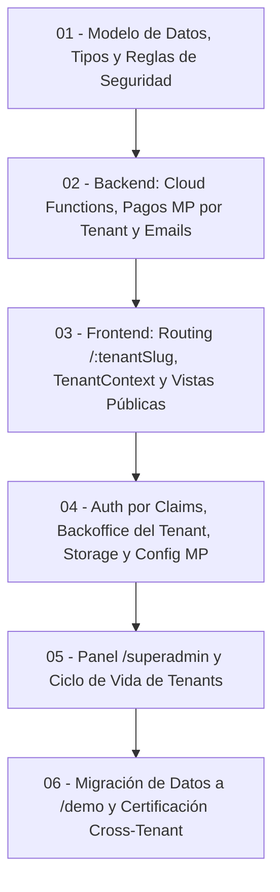

# 00 — Resumen de Arquitectura Multi-Tenant y Mapa de Fases

Este directorio contiene las especificaciones técnicas ejecutables para migrar **Turneado** desde una arquitectura *single-tenant* hacia una plataforma **SaaS Multi-Tenant** operando sobre **un único proyecto de Firebase** (Hosting, Auth, Firestore, Cloud Functions v2 y Storage).

---

## 1. Decisiones Arquitectónicas Acordadas

Las siguientes definiciones rigen sobre cualquier versión preliminar y son obligatorias en todas las fases:

1. **Identificación de Tenant por Ruta (`/:tenantSlug`) en un único Firebase Hosting:**
   - Todas las vistas de un negocio viven bajo `midominio.com/:tenantSlug/*` (ej. `/demo`, `/demo/about`, `/demo/prices`, `/demo/login`, `/demo/admin`, `/demo/payment/success`).
   - Compatible de forma nativa con el certificado SSL único y el rewrite SPA (`"**" -> "/index.html"`) de [firebase.json](file:///d:/Projects/Portfolio%20personal/Turnos-web/firebase.json), sin requerir DNS ni certificados por cliente.
2. **Comportamiento de la Ruta Raíz (`/`):**
   - La ruta `/` **redirige automáticamente a la landing del tenant demo** (`/demo`, configurable mediante `DEFAULT_DEMO_SLUG = 'demo'`), preservando la experiencia inmediata de portfolio/demostración en vivo.
3. **Resolución `slug -> tenantId` sin Enumeración y en 1 Lectura:**
   - Cada negocio posee un identificador interno inmutable (`tenantId`, ej. `tnt_demo` o `tnt_<id>`) separado de su `slug` público en la colección raíz `/tenant_slugs/{slug}` (`allow get: if true; allow list: if false`).
   - `/tenant_slugs/{slug}` incluye el bootstrap público sincronizado (`tenantId`, `slug`, `status`, `redirectToSlug?`, `timezone`, `ownerProfile`) para resolver tenant y branding inicial en **1 sola lectura de Firestore** (0 lecturas extra respecto al diseño original).
4. **Modelo Jerárquico por Subcolecciones (`/tenants/{tenantId}/...`):**
   - Aislamiento estructural de datos bajo `/tenants/{tenantId}` (`ownerinfo/profile`, `public_meta/availability`, `services/*`, `portfolio/*`, `slots/*`, `members/*`, `private_config/integrations`, `payment_attempts/*`, `payment_incidents/*`).
   - Se eliminan las colecciones legacy raíz (`/slots`, `/services`, `/prices`, `/public_slots`, `/public_meta`, `/ownerinfo`, `/portfolio`, `/payment_attempts`, `/payment_incidents`).
5. **Mercado Pago por Tenant desde el Día 1 (Opción A + Fallback Demo):**
   - Cada tenant almacena sus propias credenciales (`mpAccessToken`, `mpWebhookSecret`, `mpPublicKey?`) en `/tenants/{tenantId}/private_config/integrations` (lectura/escritura bloqueada al cliente; gestionada exclusivamente vía Cloud Functions).
   - **Regla estricta de fallback:** Solo los tenants marcados explícitamente con `isDemo: true` (administrable únicamente desde `/superadmin`) pueden usar las variables de entorno globales (`MP_ACCESS_TOKEN`, `MP_WEBHOOK_SECRET`) como respaldo. Un tenant comercial real sin credenciales propias configuradas rechaza la creación de preferencias de pago con un error controlado.
6. **Onboarding y Gobierno Centralizado vía `/superadmin`:**
   - No existe auto-registro público (*self-service signup*).
   - El alta de nuevos negocios, asignación de dueños, suspensión/reactivación, cambio de `slug` y flag `isDemo` se gestionan desde el panel privado `/superadmin`, protegido por el Custom Claim `platformAdmin: true` en Firebase Auth.
7. **Autorización Admin Zero-Trust con Custom Claims + Membresías:**
   - Fuente de verdad auditable en `/tenants/{tenantId}/members/{uid}` sincronizada vía trigger hacia Firebase Auth Custom Claims (`{ tenants: { [tenantId]: 'owner' | 'staff' }, platformAdmin?: boolean }`), logrando validación sin costo de lecturas adicionales tanto en `firestore.rules` como en `storage.rules`.

---

## 2. Topología de Rutas y Datos

```text
URLs de la Aplicación (Firebase Hosting único)
├── /                                  -> Redirect 302/replace hacia /demo
├── /superadmin/login                  -> Login exclusivo de administrador de plataforma
├── /superadmin                        -> Panel de alta y gobierno de tenants (platformAdmin == true)
└── /:tenantSlug
    ├── (index)                        -> ClientView (reserva pública de turnos del tenant)
    ├── /about                         -> Perfil y portfolio del tenant
    ├── /prices                        -> Catálogo de servicios y precios del tenant
    ├── /payment/success               -> Retorno Checkout Pro (aprobado) del tenant
    ├── /payment/failure               -> Retorno Checkout Pro (rechazado) del tenant
    ├── /payment/pending               -> Retorno Checkout Pro (pendiente) del tenant
    ├── /login                         -> Login contextualizado al backoffice del tenant
    └── /admin                         -> Panel de administración del tenant (owner | staff)
```

```text
Árbol de Datos en Firestore y Storage
Firestore:
├── /tenant_slugs/{slug}
└── /tenants/{tenantId}
    ├── /members/{uid}
    ├── /private_config/integrations
    ├── /ownerinfo/profile
    ├── /public_meta/availability
    ├── /services/{serviceId}
    ├── /portfolio/{workId}
    ├── /slots/{slotId}
    ├── /payment_attempts/{attemptId}
    └── /payment_incidents/{paymentId}

Cloud Storage:
└── /tenants/{tenantId}/{logo|profile|hero|portfolio}/{fileName}
```

---

## 3. Orden de Dependencias e Índice de Especificaciones

Cada fase construye sobre las garantías de la anterior y debe superar sus criterios de aceptación antes de avanzar:



| Spec | Fase | Responsabilidad Principal |
| :--- | :--- | :--- |
| [01-data-model-and-security-rules.md](file:///d:/Projects/Portfolio%20personal/Turnos-web/specs/01-data-model-and-security-rules.md) | **Fase 1** | Contratos TypeScript multi-tenant, `firestore.rules`, `storage.rules` e índices `COLLECTION` / `COLLECTION_GROUP`. |
| [02-backend-functions-payments-and-emails.md](file:///d:/Projects/Portfolio%20personal/Turnos-web/specs/02-backend-functions-payments-and-emails.md) | **Fase 2** | Refactor de Cloud Functions, cachés por `tenantId`, Mercado Pago Opción A + fallback `isDemo`, triggers y cron jobs `collectionGroup`. |
| [03-frontend-routing-tenant-context-and-public-views.md](file:///d:/Projects/Portfolio%20personal/Turnos-web/specs/03-frontend-routing-tenant-context-and-public-views.md) | **Fase 3** | Redirección `/` $\to$ `/demo`, `TenantProvider`, caché `sessionStorage` particionada y adaptación de vistas públicas y post-pago. |
| [04-tenant-admin-auth-storage-and-integrations.md](file:///d:/Projects/Portfolio%20personal/Turnos-web/specs/04-tenant-admin-auth-storage-and-integrations.md) | **Fase 4** | Validación de Custom Claims en cliente, `ProtectedTenantRoute`, aislamiento de Storage y pantalla Admin de credenciales MP. |
| [05-superadmin-panel-and-tenant-onboarding.md](file:///d:/Projects/Portfolio%20personal/Turnos-web/specs/05-superadmin-panel-and-tenant-onboarding.md) | **Fase 5** | Panel `/superadmin`, alta/edición/suspensión de tenants, gestión de `slug` y script de bootstrap de `platformAdmin`. |
| [06-data-migration-and-security-verification.md](file:///d:/Projects/Portfolio%20personal/Turnos-web/specs/06-data-migration-and-security-verification.md) | **Fase 6** | Migración idempotente de los datos actuales hacia el tenant `/demo` y suite automatizada de pruebas de intrusión Cross-Tenant. |

---

## 4. Política Transversal de Testing (Unitario + Integración Firebase)

Ninguna fase se considera cerrada sin validar sus cambios en ambos niveles de prueba:

1. **Tests Unitarios (`npm test`):** cubren lógica pura, validadores de slugs/tenants, resolución de credenciales, formateo de emails, cachés particionadas y helpers de migración sin dependencias de red.
2. **Tests de Integración con Firebase Emulators (`npm run test:integration`):** se ejecutan contra los emuladores reales de **Auth, Firestore, Storage y Cloud Functions** (sin mockear el SDK de Firebase) para validar reglas de seguridad, triggers, callables, suscripciones y aislamiento entre tenants introducidos o modificados en la fase.
3. **Saneamiento inicial de la suite heredada:** durante las Fases 1–3 se corrige el bug de `FieldPath` en `syncPublicSlot` y se actualizan progresivamente los tests de integración preexistentes (`securityRules`, `cloudFunctions`, `db.slots`, `db.booking`, `ownerService`, `servicesService`, `auth`, `storageService`) al modelo multi-tenant, dejando la Fase 6 enfocada en la certificación Cross-Tenant y el migrador.
