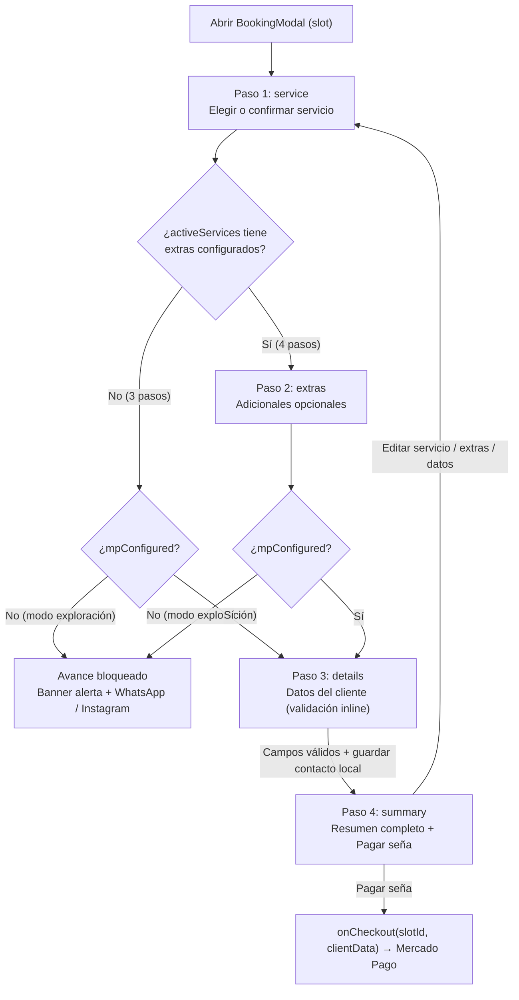

# 15 — Pasarela de Reserva y Pago en 4 Pasos (Modal Wizard en ClientView)

> **Estado:** Implementado y verificado (`BookingModal` 4 pasos + `bookingWizard.ts` + protección `bfcache`/checkout)  
> **Prioridad:** Alta (conversión, claridad y experiencia móvil en la reserva pública)  
> **Ámbito:** Pasarela de reserva cliente (`src/components/slots/BookingModal/`), Marco compartido (`src/components/slots/SlotBookingShared/`), Textos centralizados (`src/texts/components/slots/BookingModal.ts`), Integración con `ClientView` (`src/pages/ClientView/ClientView.tsx`) y Tests unitarios (`tests/unit/bookingWizard.test.ts`).

---

## 1. Objetivos y Alcance

### Problema que resuelve
Actualmente, cuando un cliente elige un horario disponible en [`ClientView.tsx`](../src/pages/ClientView/ClientView.tsx), se abre [`BookingModal.tsx`](../src/components/slots/BookingModal/BookingModal.tsx) presentando **todo el flujo apilado en un único formulario vertical con scroll**:
1. Selección de servicios (en formato de pills compactas, que se ocultan si el turno tiene un solo servicio).
2. Selección de extras agrupados por servicio.
3. Datos personales del cliente (nombre, correo, WhatsApp/teléfono y notas).
4. Recuadro de precios (`PricingReceiptBox`), aviso de bloqueo de 15 minutos y botón de pago hacia Mercado Pago.

Esta estructura presenta cuatro fricciones concretas de experiencia de usuario, especialmente en mobile (canal principal de tráfico desde Instagram y WhatsApp):
- **Alta carga cognitiva inicial:** el usuario enfrenta simultáneamente decisiones de catálogo, carga de datos personales y monto a pagar dentro de una misma pantalla larga.
- **Validaciones tardías e intrusivas:** los errores de formulario (nombre, email, teléfono) recién se detectan al final mediante un popup modal (`AlertModal`) en lugar de validarse inline por campo antes de revisar el resumen.
- **Sin instancia dedicada de confirmación previa al pago:** el cliente no cuenta con un paso explícito de revisión final (turno + servicios/extras + datos ingresados + desglose económico) antes de ser redirigido a Mercado Pago.
- **Fricción para clientes recurrentes:** cada nueva reserva obliga a tipear nuevamente nombre, correo y WhatsApp desde cero.

### Principio arquitectónico clave: **0 impacto en backend y sin regresiones en AdminView**
Esta especificación opera **100% en el frontend**:
- **0 cambios en Cloud Functions, Firestore Rules o contratos de `ClientData` / `createPreference`.**
- **0 lecturas adicionales a Cloud Firestore:** reutiliza en vivo `slots`, `blockingSlots`, `liveSelectedSlot`, `mpConfigured` y el hook [`useSlotBookingForm`](../src/components/slots/SlotBookingShared/useSlotBookingForm.ts).
- **Aislamiento respecto al backoffice:** [`AssignSlotModal.tsx`](../src/components/admin/AssignSlotModal/AssignSlotModal.tsx) continúa utilizando `SlotBookingShared` en formato rápido de vista única para el operador del negocio, sin alteraciones visuales ni de comportamiento.

### Qué incluye esta especificación
1. **Modal Wizard guiado de hasta 4 pasos** (modal centrado en desktop / bottom-sheet en mobile):
   - **Paso 1 — Elegir servicio:** siempre visible, con tarjetas seleccionables enriquecidas (nombre, duración, precio base e indicador de extras opcionales), selección múltiple habilitada y detección inmediata de conflictos de duración.
   - **Paso 2 — Elegir extras:** visible únicamente cuando al menos un servicio seleccionado posee extras configurados (`hasConfiguredExtras === true`); se omite dinámicamente cuando no aplica (ajustando el flujo y el stepper a 3 pasos).
   - **Paso 3 — Rellenar datos:** campos de contacto y notas con **validación inline** por campo (limpiando el error al corregir) y **persistencia en `localStorage`** de nombre, email y WhatsApp para futuras reservas.
   - **Paso 4 — Resumen y pago:** comprobante previo estructurado (turno, servicios y extras, datos del cliente con atajos `"Editar"`, `PricingReceiptBox`, aviso de reserva segura de 15 min) y CTA hacia Mercado Pago.
2. **Stepper superior accesible y clicable** para volver a cualquier paso completado, complementado por botones `Cancelar` / `Volver` y `Continuar` / `Pagar seña` en el footer fijo.
3. **Resumen económico compacto en vivo** durante los Pasos 1 a 3 (fecha, horario, duración acumulada, total estimado actualizado al instante y seña).
4. **Modo exploración cuando Mercado Pago no está configurado (`!mpConfigured`):** mantiene visible el banner de alerta con accesos directos a WhatsApp / Instagram y permite recorrer **Paso 1 (Servicio)** y **Paso 2 (Extras)** para consultar servicios, adicionales y total estimado en vivo, **bloqueando el avance a Paso 3 (Tus datos) y Paso 4 (Resumen y pago)**.
5. **Módulo puro testeable** (`bookingWizard.ts`) + suite unitaria completa (`tests/unit/bookingWizard.test.ts`).

### Qué queda explícitamente fuera de alcance
- Cambios en la lógica de cobro, webhook, expiración de 15 minutos o pantallas de retorno (`PaymentSuccess`, `PaymentFailure`).
- Conversión de `AssignSlotModal` (AdminView) a formato wizard.
- Nueva ruta URL dedicada por paso (la pasarela vive en el modal de `ClientView` preservando la posición de scroll y el estado de filtros de la agenda).
- Checkout integrado (Mercado Pago Bricks/CardForm dentro de la app): el CTA del Paso 4 mantiene la redirección segura al `initPoint` de Checkout Pro generado por `onCheckout`.

---

## 2. Arquitectura, Máquina de Estados y Contratos

### 2.1 Flujo de estados de la pasarela



### 2.2 Tipos y contratos (`src/components/slots/BookingModal/bookingWizard.ts`)

```ts
export type BookingWizardStepId = 'service' | 'extras' | 'details' | 'summary';

export interface BookingClientFields {
  name: string;
  email: string;
  phone: string;
  notes: string;
}

export interface BookingFieldErrors {
  name?: string;
  email?: string;
  phone?: string;
  notes?: string;
}

export interface SavedBookingContact {
  name: string;
  email: string;
  phone: string;
}
```

#### Funciones puras exportadas
| Función | Firma / Comportamiento |
| :--- | :--- |
| `getVisibleWizardSteps` | `(hasConfiguredExtras: boolean) => BookingWizardStepId[]` — Devuelve `['service', 'extras', 'details', 'summary']` si `true`, o `['service', 'details', 'summary']` si `false`. |
| `isStepLockedByPaymentDisabled` | `(stepId: BookingWizardStepId, isOnlinePaymentDisabled: boolean) => boolean` — Devuelve `true` únicamente cuando `isOnlinePaymentDisabled && (stepId === 'details' || stepId === 'summary')`. |
| `resolveEffectiveWizardStep` | `(currentStep, visibleSteps, isOnlinePaymentDisabled) => BookingWizardStepId` — Si `currentStep` dejó de existir (ej. `extras` al deseleccionar un servicio) o quedó bloqueado por `!mpConfigured`, resuelve el paso válido inmediatamente anterior (`service` o `extras`). |
| `getNextWizardStep` | `(currentStep, visibleSteps) => BookingWizardStepId \| null` — Devuelve el siguiente paso visible o `null` si está en `summary`. |
| `getPrevWizardStep` | `(currentStep, visibleSteps) => BookingWizardStepId \| null` — Devuelve el paso anterior visible o `null` si está en `service`. |
| `canNavigateToWizardStep` | `(params: { targetStep, currentStep, highestReachedStep, visibleSteps, isOnlinePaymentDisabled }) => boolean` — Permite hacer clic en el stepper para saltar a pasos previos (`targetIndex < currentIndex`) o ya alcanzados (`targetIndex <= highestReachedIndex`) siempre que no estén bloqueados por `!mpConfigured`, no superen pasos con dependencias invalidadas y `targetStep !== currentStep`. |
| `validateBookingClientFields` | `(fields: BookingClientFields) => { isValid: boolean; errors: BookingFieldErrors }` — Aplica exactamente las reglas vigentes de `validators.ts` + `FIELD_LIMITS.booking`. |
| `loadSavedBookingContact` | `() => SavedBookingContact \| null` — Lee `localStorage['turneado_booking_contact_v1']`, valida tipos, recorta a `FIELD_LIMITS` y retorna `null` ante datos vacíos, JSON corrupto o error de almacenamiento. |
| `saveBookingContact` | `(contact: SavedBookingContact) => void` — Persiste `{ name, email, phone }` recortados en `localStorage` (excluyendo `notes`) dentro de `try/catch`. |
| `clearSavedBookingContact` | `() => void` — Elimina la clave de `localStorage` dentro de `try/catch`. |

### 2.3 Matriz de reglas de negocio y casos borde

| Caso borde | Comportamiento esperado |
| :--- | :--- |
| **Turno con 1 solo servicio** (`relevantServices.length === 1`) | Paso 1 se muestra igualmente con el servicio único preseleccionado en una tarjeta confirmada (`Incluido en este turno`), no removible. El botón `Continuar` está habilitado de inmediato (salvo conflicto de horario o turno ocupado). |
| **Turno con múltiples servicios y 0 elegidos** | Al tocar `Continuar` en Paso 1, se muestra un aviso inline debajo de las tarjetas solicitando elegir al menos un servicio (sin abrir `AlertModal`). |
| **Conflicto de duración en vivo** (`hasLiveDurationConflict`) | Se muestra el banner rojo `liveConflictBanner` en Paso 1 apenas se combinan servicios cuya suma se superpone con otro turno; deshabilita `Continuar` y `Pagar seña` hasta ajustar la selección. |
| **Servicios sin extras configurados** (`hasConfiguredExtras === false`) | El paso `extras` no aparece en el stepper ni en la secuencia (3 pasos totales: `Servicio → Tus datos → Resumen`). |
| **Cambio de servicios desde Paso 4 (`Editar`)** | Si el usuario vuelve a Paso 1 y agrega un servicio con extras, `extras` se reincorpora a `visibleSteps` y al avanzar pasa por Paso 2. Si quita el servicio que tenía extras, `useSlotBookingForm` limpia los extras de ese servicio y el stepper vuelve a 3 pasos sin quedar huérfano. |
| **Mercado Pago no configurado** (`!mpConfigured`) | El modal abre normalmente mostrando `mpUnavailableBanner` (con links a WhatsApp / Instagram) arriba del paso activo. El usuario puede elegir/combinar servicios en Paso 1 y, si hay extras, tocar `Continuar` para explorar Paso 2 y ver el estimado en vivo. En el paso previo a `details` (`extras` si existe, o `service` si no hay extras), el botón primario queda deshabilitado con el texto `Pagos online no habilitados` y los pasos `Tus datos` y `Resumen` figuran bloqueados en el stepper. |
| **Turno ocupado en tiempo real** (`isSlotUnavailable`) | El banner rojo de disponibilidad aparece fijado arriba del paso activo en cualquier paso (`1..4`) y deshabilita tanto `Continuar` como `Pagar seña`. |
| **Tecla `Enter` dentro del formulario** | En Pasos 1–3, enviar el `<form>` intenta avanzar al paso siguiente (ejecutando la validación del paso actual y respetando el bloqueo `!mpConfigured`), nunca dispara `onCheckout` prematuramente. Solo dispara `onCheckout` cuando `effectiveStep === 'summary'`. |
| **Persistencia de contacto en `localStorage`** | Se guarda solo `{ name, email, phone }` al validar y avanzar desde Paso 3 (y al iniciar checkout). Nunca se guardan `notes`. Al reabrir el modal, los campos aparecen precargados con una píldora discreta y botón `"Limpiar"` para vaciar los campos y borrar el almacenamiento local. |
| **Accesibilidad y movimiento reducido** | Transiciones horizontales suaves entre pasos con `motion/react` (`AnimatePresence`) que degradan a cambio instantáneo cuando `useReducedMotion()` es `true`. Cada cambio de paso hace `scrollTop = 0` en `.formBody`. |

---

## 3. Archivos Afectados

### Archivos a crear
- `src/components/slots/BookingModal/bookingWizard.ts` — Lógica pura del wizard, validaciones inline y persistencia de contacto en `localStorage`.
- `src/components/slots/BookingModal/BookingWizardStepper.tsx` — Barra de progreso accesible (3 o 4 pasos) con soporte de navegación hacia pasos completados y estado bloqueado (`!mpConfigured`).
- `src/components/slots/BookingModal/BookingWizardSteps.tsx` — Vistas dedicadas `ServiceStep`, `ExtrasStep`, `ClientDetailsStep` y `SummaryPaymentStep`.
- `src/components/slots/BookingModal/BookingModal.module.css` — Estilos específicos del stepper, tarjetas de servicio, barra de contacto recordado, resumen estructurado y footer con monto en vivo (100% basado en variables CSS de `src/styles/variables.css`, light + dark + mobile `<= 580px`).
- `tests/unit/bookingWizard.test.ts` — Suite unitaria para todas las funciones puras de `bookingWizard.ts`.

### Archivos a modificar — Frontend
- [`src/components/slots/SlotBookingShared/SlotBookingModalFrame.tsx`](../src/components/slots/SlotBookingShared/SlotBookingModalFrame.tsx)
  - Agregar props opcionales `headerExtra?: React.ReactNode`, `formBodyRef?: React.RefObject<HTMLDivElement | null>` y `contextEstimatedTotal?: number` manteniendo 100% compatibilidad retroactiva con `AssignSlotModal`.
- [`src/components/slots/SlotBookingShared/SlotBookingModal.module.css`](../src/components/slots/SlotBookingShared/SlotBookingModal.module.css)
  - Ajustes mínimos opcionales para el contenedor de `headerExtra` y cifra de estimado en `contextStrip` (sin alterar el layout de `AssignSlotModal`).
- [`src/components/slots/BookingModal/BookingModal.tsx`](../src/components/slots/BookingModal/BookingModal.tsx)
  - Orquestar estado del wizard, transiciones por paso, validación temprana, modo exploración `!mpConfigured`, guardado de contacto local, resumen en vivo en footer y envío final en Paso 4.
- [`src/texts/components/slots/BookingModal.ts`](../src/texts/components/slots/BookingModal.ts)
  - Incorporar sección `wizard` con todos los textos tipados del flujo en 4 pasos, preservando las claves existentes y lenguaje neutro ("Saldo pendiente", sin mencionar efectivo ni presencial).

### Tests a crear/actualizar
- `tests/unit/bookingWizard.test.ts` (nuevo).
- Verificar sin cambios (o ampliar si se ajusta algún helper compartido) [`tests/unit/slotBookingShared.test.ts`](../tests/unit/slotBookingShared.test.ts).

---

## 4. Diseño Detallado por Componente y Paso

### 4.1 Extensión retrocompatible de `SlotBookingModalFrame`
```ts
export interface SlotBookingModalFrameProps {
  // ...props existentes sin cambios
  headerExtra?: React.ReactNode;
  formBodyRef?: React.RefObject<HTMLDivElement | null>;
}
```
- `headerExtra` se renderiza dentro de `.modalHeader`, inmediatamente debajo de `.contextStrip`, asegurando que el stepper permanezca siempre fijo mientras el cuerpo `.formBody` hace scroll.
- `formBodyRef` se vincula a `<div ref={formBodyRef} className={styles.formBody}>` para resetear el scroll al cambiar de paso.
- `AssignSlotModal` no pasa estas props y conserva su renderizado idéntico.

### 4.2 Stepper accesible (`BookingWizardStepper`)
- Estructura semántica: `<nav className={styles.stepperNav} aria-label={...}><ol className={styles.stepperList}>...</ol></nav>`.
- Cada ítem muestra:
  - **Círculo indicador:** tilde (`Check`) si fue completado, candado sutil (`Lock`, 11px) si está bloqueado por `!mpConfigured`, o número de paso (`1..4`) si está activo/pendiente.
  - **Etiqueta corta:** `Servicio`, `Extras`, `Tus datos`, `Resumen`.
- **Interacción:**
  - Pasos clickeables (`canNavigateToWizardStep === true`): `<button type="button">` con hover y `:focus-visible`.
  - Paso activo: marcado con `aria-current="step"`, realce con `--color-primary` y peso semibold.
  - Pasos bloqueados por `!mpConfigured`: opacidad atenuada y `disabled`, comunicando visualmente que se detiene antes de datos/pago.
- **Responsive (`<= 580px`):** grid equitativo de 3 o 4 columnas (`grid-template-columns: repeat(var(--step-count), minmax(0, 1fr))`) con indicador arriba y etiqueta compacta debajo (`font-size: 0.7rem`, sin desborde horizontal).

### 4.3 Paso 1 — Elegir servicio (`ServiceStep`)
- Cabecera de paso limpia: título (`Elegí tu servicio` / `Servicio incluido en este turno` si es único) + subtítulo breve (ej. *"Podés combinar más de un servicio si el horario lo permite."*).
- Lista vertical de **tarjetas seleccionables** (`button[type="button"][aria-pressed]`):
  - **Izquierda:** indicador visual de selección (círculo/checkbox con `Check` cuando está activo) + nombre del servicio + metadatos (`Clock` + duración compacta, y pill discreta `+N extras opcionales` si `(service.extras?.length ?? 0) > 0`).
  - **Derecha:** precio base en `tabular-nums` (`$15.000`, o `A confirmar` si `basePrice === 0`).
  - **Estado único (`relevantServices.length === 1`):** tarjeta fija en estado activo con badge `Incluido` (sin permitir desmarcarla) para que el usuario confirme de un vistazo servicio, duración y precio base.
- Si se intenta tocar `Continuar` con `activeServices.length === 0`, se muestra un mensaje inline con `role="alert"` (`serviceStepError`) que se limpia automáticamente al seleccionar un servicio.

### 4.4 Paso 2 — Elegir extras (`ExtrasStep`)
- Solo se renderiza cuando `hasConfiguredExtras === true`.
- Cabecera de paso: título (`Sumá extras opcionales`) + subtítulo (*"Personalizá tu turno o continuá directamente si no necesitás adicionales."*) + pill resumen a la derecha cuando `selectedExtrasCount > 0` (`2 seleccionados · +$4.500`).
- Agrupa las opciones por servicio activo (`activeServices` que tengan `extras.length > 0`) usando filas accesibles (`<label>` + `<input type="checkbox">`) con alto táctil cómodo (`min-height: 46px` en mobile) y precio `+$X` alineado a la derecha en `tabular-nums`.

### 4.5 Paso 3 — Rellenar datos (`ClientDetailsStep`)
- Cabecera de paso: título (`Completá tus datos`) + subtítulo (*"Los usamos para enviarte el comprobante y recordarte tu turno."*).
- **Barra de contacto recordado (condicional):** si el modal precargó datos desde `localStorage` y el usuario aún no los limpió, muestra una fila discreta con ícono `UserCheck` / `Sparkles`-free (`History` o `User`, evitando íconos genéricos AI): *"Completamos tus datos de tu última reserva"* + botón secundario compacto `"Limpiar"`.
- Campos usando los componentes del design system:
  - `Input` Nombre y apellido (`required`, `autoComplete="name"`, `error={fieldErrors.name}`)
  - `Input` Correo electrónico (`type="email"`, `required`, `autoComplete="email"`, `error={fieldErrors.email}`)
  - `Input` WhatsApp / Teléfono (`type="tel"`, `phoneOnly`, `required`, `autoComplete="tel"`, `error={fieldErrors.phone}`)
  - `Textarea` Notas opcionales (`rows={3}`, `error={fieldErrors.notes}`)
- **Limpieza inmediata de errores:** modificar cualquier campo limpia exclusivamente `fieldErrors[campo]` para feedback instantáneo y cero fricción.
- Al validar correctamente y avanzar a Paso 4, persiste `{ name, email, phone }` en `localStorage`.

### 4.6 Paso 4 — Resumen y pago (`SummaryPaymentStep`)
- Cabecera de paso: título (`Revisá y confirmá tu reserva`) + subtítulo (*"Verificá los detalles antes de pasar al pago seguro con Mercado Pago."*).
- **Tarjeta estructurada de resumen** dividida en 3 bloques limpios con bordes `--border-subtle`:
  1. **Turno:** fecha completa, horario (`HH:mm hs`), duración total estimada y `SurchargeBadge` con motivo si aplica.
  2. **Servicios y extras:** listado de cada servicio elegido con su precio base y, debajo con indentación sutil, los extras tildados (`+ Nombre extra · +$X`), más botón inline **`Editar`** (salta a Paso 1; y si hay extras configurados, un acceso rápido secundario a Paso 2 o directamente `Editar servicios` / `Editar extras`).
  3. **Tus datos:** nombre completo, correo electrónico, WhatsApp/teléfono y notas (si se completaron) + botón inline **`Editar`** (salta directo a Paso 3).
- **`PricingReceiptBox`:** reutilizado directamente desde `SlotBookingShared`, mostrando Precio Base, Extras, Recargo (si aplica), Total Estimado, Seña a pagar online (Mercado Pago) y Saldo pendiente.
- **Aviso de reserva segura:** texto con `ShieldCheck` recordando el bloqueo temporal de 15 minutos al iniciar el pago.

### 4.7 Footer fijo, resumen en vivo y modo exploración (`!mpConfigured`)
- **En Pasos 1 a 3 (`effectiveStep !== 'summary'`):**
  - **Franja/bloque de resumen en vivo:** muestra de forma compacta el estado económico actual (`Total est. $XX.XXX · Seña $X.XXX`, o solo `Seña $X.XXX` si `totalFinalEstimatedPrice === 0`) y la duración estimada, actualizándose en vivo con cada clic en servicios/extras.
  - **Botón izquierdo (`variant="secondary"`):**
    - En Paso 1 (`service`): `Cancelar` (cierra el modal).
    - En Pasos 2 y 3 (`extras`, `details`): `Volver` (retrocede al paso visible anterior).
  - **Botón derecho (`variant="primary"`):**
    - Si `isOnlinePaymentDisabled && nextStep === 'details'`: deshabilitado con texto `Pagos online no habilitados` (bloqueando el ingreso a datos y pago mientras deja explorar Paso 1 y Paso 2).
    - En caso contrario: `Continuar` con ícono `ArrowRight` (deshabilitado si `isSlotUnavailable` o si `effectiveStep === 'service' && hasLiveDurationConflict`).
- **En Paso 4 (`effectiveStep === 'summary'`):**
  - **Botón izquierdo (`variant="secondary"`):** `Volver` (regresa a Paso 3).
  - **Botón derecho (`variant="primary"`):** `Pagar seña de $X` con `CreditCard` y `isLoading` (deshabilitado si `isLoading || isSlotUnavailable || hasLiveDurationConflict || isOnlinePaymentDisabled`).
- **En mobile (`<= 580px`):** el resumen compacto en vivo se acomoda limpiamente sobre la fila de botones respetando `env(safe-area-inset-bottom, 0px)` y objetivos táctiles mínimos de `44px`.

### 4.8 Diccionario de textos (`src/texts/components/slots/BookingModal.ts`)
- Mantener todas las claves existentes (`header`, `services`, `extras`, `form`, `pricing`, `disclaimer`, `footer`, `mpNotConfigured`, `loader`, `alerts`, `logs`) para evitar cualquier rotura.
- Agregar bloque `wizard` con:
  - `stepperAriaLabel`, `steps`: `{ service: 'Servicio', extras: 'Extras', details: 'Tus datos', summary: 'Resumen' }`.
  - Títulos y subtítulos breves por paso.
  - Textos de tarjeta de servicio (`includedBadge: 'Incluido'`, `extrasAvailableHint`, `priceToConfirm: 'A confirmar'`, `selectAtLeastOneError`).
  - Texto de contacto recordado (`prefilledNotice`, `clearPrefilledAction`).
  - Etiquetas de resumen (`turnSectionTitle`, `servicesSectionTitle`, `extrasSectionTitle`, `clientSectionTitle`, `editAction`, `noExtrasSelected`).
  - Etiquetas de navegación (`backButton: 'Volver'`, `continueButton: 'Continuar'`, `liveTotalPrefix: 'Total est.'`, `liveDepositPrefix: 'Seña'`).
  - Respetar el copy neutro del proyecto (siempre **"Saldo pendiente"**, nunca "efectivo" ni "presencial").

---

## 5. Plan de Acción por Fases

### Fase 1 — Lógica pura del wizard y pruebas unitarias
1. Crear `src/components/slots/BookingModal/bookingWizard.ts` con tipos, máquina de pasos, validación inline y persistencia segura en `localStorage`.
2. Crear `tests/unit/bookingWizard.test.ts` cubriendo 4 pasos vs 3 pasos, resolución de paso efectivo al quitar servicios, modo exploración `!mpConfigured`, reglas de navegación del stepper, validación de todos los campos y persistencia/saneamiento de `localStorage`.

### Fase 2 — Extensión retrocompatible del marco y textos
1. Actualizar `src/components/slots/SlotBookingShared/SlotBookingModalFrame.tsx` y `SlotBookingModal.module.css` con `headerExtra` y `formBodyRef`.
2. Extender `src/texts/components/slots/BookingModal.ts` con el diccionario `wizard`.

### Fase 3 — Interfaz de pasos, stepper y orquestación en `BookingModal`
1. Crear `src/components/slots/BookingModal/BookingWizardStepper.tsx`.
2. Crear `src/components/slots/BookingModal/BookingWizardSteps.tsx`.
3. Crear `src/components/slots/BookingModal/BookingModal.module.css` usando tokens de `src/styles/variables.css` (compatible con light/dark, paletas de tenants y mobile `<= 580px`).
4. Refactorizar `src/components/slots/BookingModal/BookingModal.tsx` integrando stepper, pasos, transiciones accesibles (`useReducedMotion`), modo exploración `!mpConfigured`, manejo correcto de `Enter`, scroll-to-top al cambiar de paso y precarga/guardado de contacto.

### Fase 4 — Verificación y QA visual
1. Correr tests unitarios completos, ESLint sobre los archivos modificados, typecheck y build de producción.
2. Verificar comportamiento en desktop y mobile (`360px`–`390px`), tema claro y oscuro, y no-regresión en `AssignSlotModal`.

---

## 6. Criterios de Aceptación y Verificación

### Verificación automatizada
- [ ] `npm test` (Vitest) 100% en verde incluyendo `tests/unit/bookingWizard.test.ts` y `tests/unit/slotBookingShared.test.ts`.
- [ ] `npx eslint src/components/slots/BookingModal/ src/components/slots/SlotBookingShared/ src/texts/components/slots/BookingModal.ts tests/unit/bookingWizard.test.ts` sin errores ni warnings nuevos.
- [ ] `npx tsc --noEmit` sin errores.
- [ ] `npm run build` sin errores.

### Verificación manual / UX y accesibilidad
- [ ] **Turno con múltiples servicios y extras:** recorre los 4 pasos (`Servicio → Extras → Tus datos → Resumen`), permite selección múltiple, actualiza duración y total estimado en vivo y alerta inmediatamente si hay conflicto de duración en Paso 1.
- [ ] **Turno con 1 solo servicio sin extras:** muestra Paso 1 con el servicio único confirmado (`Incluido`) y salta automáticamente a `Tus datos` (stepper en 3 pasos).
- [ ] **Paso 3 (validación y persistencia):** muestra errores inline debajo de cada campo inválido al tocar `Continuar`, limpia cada error al tipear, guarda nombre/email/WhatsApp en `localStorage` (sin notas) y permite limpiarlos en la siguiente reserva.
- [ ] **Paso 4 (resumen y navegación):** muestra turno, servicios/extras, datos del cliente con atajos `Editar`, `PricingReceiptBox`, aviso de 15 min y botón `Pagar seña de $X` que redirige a Mercado Pago; los pasos completados del stepper son clicables.
- [ ] **Mercado Pago no configurado (`!mpConfigured`):** muestra la alerta con links de WhatsApp/Instagram arriba del wizard, permite seleccionar servicios en Paso 1 y explorar extras en Paso 2 viendo el total estimado en vivo, pero bloquea el paso a `Tus datos` y `Resumen` tanto por botón como por stepper y tecla `Enter`.
- [ ] **No-regresión en `AdminView`:** `AssignSlotModal` abre y asigna turnos en vista única exactamente igual que antes.
- [ ] **Responsividad y temas:** sin desbordes horizontales ni solapamientos en mobile (`360px`–`430px`) ni desktop, validado en modo claro y oscuro.
