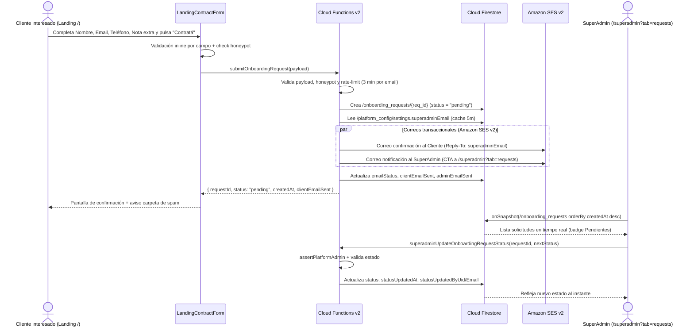
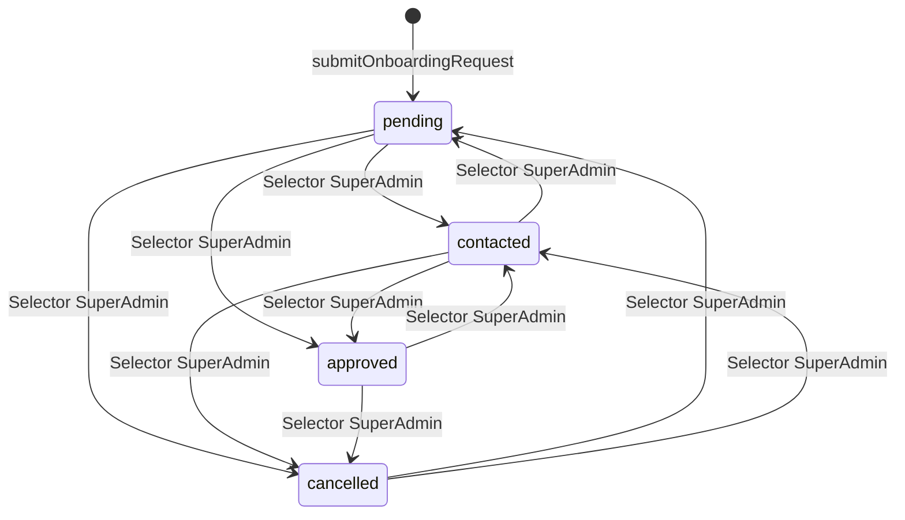

# 16 — Formulario de Contratación en Landing, Email SuperAdmin SSOT desde CLI `init` y Apartado "Solicitudes" en `/superadmin`

> **Estado:** Listo para implementar  
> **Prioridad:** Alta (captación comercial directa, trazabilidad de leads y simplificación operativa de plataforma)  
> **Ámbito:** Landing comercial (`src/pages/Landing/`), Panel de plataforma (`src/pages/SuperAdminView/`), Servicio frontend (`src/services/onboardingRequestService.ts`), Backend serverless (`functions/src/platformConfig.ts`, `functions/src/onboardingRequests.ts`, `functions/src/emailService.ts`, `functions/src/ownerProfile.ts`, `functions/src/index.ts`), Reglas e índices (`firestore.rules`, `firestore.indexes.json`), CLI operativa (`scripts/cli/commands/init.mjs`, `backup.mjs`, `reset.mjs`) y Tests unitarios/integración.

---

## 1. Objetivos y Alcance

### Problema que resuelve
Actualmente la Landing comercial (`/`) deriva toda intención de contratación hacia un enlace externo de WhatsApp, lo que implica:
- **Sin trazabilidad dentro de Turneado:** no existe registro estructurado de interesados ni seguimiento de en qué estado comercial se encuentra cada lead.
- **Sin confirmación automática por email:** el cliente no recibe respaldo formal de que su consulta/solicitud fue registrada, ni el SuperAdmin recibe una ficha estructurada accionable en su casilla.
- **Configuración de email dispersa:** `functions/.env.example` aún mantiene la variable legacy `BUSINESS_EMAIL` (y el código lee `BUSINESS_EMAIL || OWNER_EMAIL`), duplicando la definición del correo del administrador principal que ya se ingresa al inicializar el proyecto con `npm run cli -- init --admin-email <correo>`.

### Qué incluye esta especificación
1. **Única Fuente de Verdad (SSOT) para el email del SuperAdmin desde CLI `init`:**
   - `npm run cli -- init --admin-email <correo>` persiste `/platform_config/settings` (`superadminEmail`, `superadminUid`, `updatedAt`, `updatedBy: 'cli:init'`).
   - Se **elimina por completo `BUSINESS_EMAIL` (y `OWNER_EMAIL`)** del backend y de `functions/.env.example`, sin agregar nuevas variables de entorno (`SUPERADMIN_NOTIFICATION_EMAIL` no es necesaria).
   - Se garantiza **cero repeticiones**: cada solicitud dispara exactamente **1 correo al cliente** y **1 correo al SuperAdmin principal**.
2. **Refactorización del Landing (`/`) con Formulario de Contratación (`#contratar`):**
   - Formulario integrado con la estética editorial del Landing, solicitando: **Nombre**, **Email**, **Teléfono** y **Nota extra** (opcional) + botón **`Contratá`**.
   - CTAs principales del Landing (Hero / Precios / Header) conectados mediante scroll suave hacia `#contratar` (conservando WhatsApp como canal secundario complementario).
   - Validación inline por campo, honeypot anti-bots, manejo de rate-limit y pantalla de confirmación con recordatorio de revisar la carpeta de spam.
3. **Backend Serverless (`submitOnboardingRequest` y `superadminUpdateOnboardingRequestStatus`):**
   - Creación segura de solicitudes en `/onboarding_requests/{requestId}` con estado inicial `pending` (`Pendiente`).
   - Envío de correos transaccionales HTML + texto plano vía Amazon SES v2 (`sesMailer.ts`) al cliente y al SuperAdmin.
   - Mutación de estado autenticada (`platformAdmin`) hacia `pending | contacted | cancelled | approved`.
4. **Nuevo apartado `Solicitudes` en `/superadmin`:**
   - Navegación de primer nivel por pestañas sincronizada con `?tab=tenants|requests` (**Negocios** y **Solicitudes**, con badge en vivo de solicitudes pendientes).
   - Métricas rápidas, filtros por estado, búsqueda en tiempo real, accesos 1-clic a Email/WhatsApp, **selector `<select>` de estado** (`Pendiente`, `Contactado`, `Cancelado`, `Aprobado`) y atajo **"Crear negocio"** que abre `CreateTenantModal` prellenando el email del solicitante.

### Qué queda explícitamente fuera de alcance
- Aprobación automática que cree el tenant sin intervención del SuperAdmin (el botón **"Crear negocio"** facilita el alta prellenando el email, pero el alta sigue siendo explícita y controlada).
- Envío automático de correos adicionales al cliente cada vez que cambia el estado interno (`Contactado`, `Cancelado`, `Aprobado`).
- Edición libre de los datos originales enviados por el solicitante o eliminación física de solicitudes desde la UI.
- Re-incorporación de `BUSINESS_EMAIL` o múltiples casillas de notificación en `.env`.

---

## 2. Arquitectura y Flujos Principales

### 2.1 Flujo End-to-End (Landing → Cloud Function → SES → `/superadmin`)



### 2.2 Transiciones de Estado de una Solicitud



> El selector en `/superadmin` permite mover una solicitud libremente entre cualquiera de los 4 estados (`Pendiente`, `Contactado`, `Cancelado`, `Aprobado`) para corregir errores operativos o reactivar un lead descartado previamente.

### 2.3 Estrategia SSOT del Correo SuperAdmin (y Eliminación de `BUSINESS_EMAIL`)

| Aspecto | Estado anterior | Estado objetivo (Spec 16) |
| :--- | :--- | :--- |
| **Correo del SuperAdmin** | No persistido como configuración de plataforma | Persistido únicamente por `npm run cli -- init --admin-email <correo>` en `/platform_config/settings` |
| **Variables en `functions/.env`** | `BUSINESS_EMAIL` (legacy demo fallback) | **Eliminada** `BUSINESS_EMAIL` (y `OWNER_EMAIL`); **0 variables nuevas** |
| **Notificación de solicitudes** | Inexistente | Lee `/platform_config/settings.superadminEmail` (con caché TTL 5 min; fallback de compatibilidad al primer `platformAdmin` en Auth solo si el doc aún no existe) |
| **Fallback de `/demo` sin email en perfil** | `process.env.BUSINESS_EMAIL` en `ownerProfile.ts` | Usa `getPlatformSuperAdminEmail(db)` solo cuando `isDemo === true`; negocios comerciales (`isDemo === false`) mantienen aislamiento estricto |

---

## 3. Modelo de Datos, Reglas de Seguridad e Índices

### 3.1 Colección `/platform_config/settings` (Singleton backend-only)

```ts
export interface PlatformSettingsDoc {
  superadminEmail: string; // normalizado lowercase
  superadminUid: string;
  updatedAt: string;       // ISO 8601
  updatedBy: string;       // 'cli:init'
}
```

### 3.2 Colección `/onboarding_requests/{requestId}` (1 documento por solicitud)

> **Decisión arquitectónica:** se utiliza una colección raíz con 1 documento por solicitud (ID `req_<12 hex>`) en lugar de un único documento contenedor para evitar el techo de **1 MiB** de Firestore y eliminar contención de escritura bajo envíos concurrentes.

```ts
export type OnboardingRequestStatus = 'pending' | 'contacted' | 'cancelled' | 'approved';

export type OnboardingRequestEmailStatus = 'sent' | 'partial' | 'failed' | 'skipped';

export interface OnboardingRequestDoc {
  id: string;
  name: string;                          // 2..80 caracteres
  email: string;                         // normalizado lowercase, <= 120 caracteres
  phone: string;                         // 6..25 caracteres (>= 6 dígitos)
  notes: string;                         // opcional, 0..500 caracteres
  status: OnboardingRequestStatus;       // 'pending' al crearse
  source: 'landing';
  emailStatus: OnboardingRequestEmailStatus;
  clientEmailSent: boolean;
  adminEmailSent: boolean;
  createdAt: string;                     // ISO 8601
  updatedAt: string;                     // ISO 8601
  statusUpdatedAt: string | null;
  statusUpdatedByUid: string | null;
  statusUpdatedByEmail: string | null;
}
```

### 3.3 Reglas de Seguridad (`firestore.rules`)

Agregar dentro de `match /databases/{database}/documents`:

```firestore
    // Configuración interna de plataforma (solo Admin SDK / CLI).
    match /platform_config/{docId} {
      allow read, write: if false;
    }

    // Solicitudes comerciales de contratación desde la Landing.
    match /onboarding_requests/{requestId} {
      allow get, list: if isPlatformAdmin();
      allow write: if false;
    }
```

### 3.4 Índices Compuestos (`firestore.indexes.json`)

Agregar el siguiente índice sobre la colección `onboarding_requests` para el control de rate-limit por correo:

```json
    {
      "collectionGroup": "onboarding_requests",
      "queryScope": "COLLECTION",
      "fields": [
        {
          "fieldPath": "email",
          "order": "ASCENDING"
        },
        {
          "fieldPath": "createdAt",
          "order": "DESCENDING"
        }
      ]
    }
```

---

## 4. Especificación Backend (`functions/src/`)

### 4.1 Nuevo módulo `functions/src/platformConfig.ts`
- Constantes exportadas:
  - `PLATFORM_CONFIG_COLLECTION = 'platform_config'`
  - `PLATFORM_SETTINGS_DOC_ID = 'settings'`
  - `PLATFORM_CONFIG_CACHE_TTL_MS = 5 * 60 * 1000`
- Funciones exportadas:
  - `getPlatformSettingsRef(db)` → `db.collection('platform_config').doc('settings')`
  - `resetPlatformConfigCache()` → limpia caché en memoria (para tests).
  - `getPlatformSuperAdminEmail(db, authClient?, nowMs?)`:
    1. Si existe entrada vigente en caché (< 5 min), retorna el email cacheado.
    2. Lee `/platform_config/settings`. Si `superadminEmail` es válido (`isValidEmail`), cachea y retorna en lowercase.
    3. Fallback de compatibilidad (solo si el documento todavía no existe): si se pasa `authClient`, lista hasta 100 usuarios y toma el primer usuario con `customClaims?.platformAdmin === true` y email válido, lo cachea y lo retorna (un único correo, nunca múltiples).
    4. Si no hay ninguno configurado, retorna `''` (y emite `logger.warn`).

### 4.2 Nuevo módulo `functions/src/onboardingRequests.ts`
- **Constantes:**
  - `ONBOARDING_REQUESTS_COLLECTION = 'onboarding_requests'`
  - `ONBOARDING_REQUEST_STATUSES = ['pending', 'contacted', 'cancelled', 'approved'] as const`
  - `RATE_LIMIT_WINDOW_MS = 3 * 60 * 1000` (3 minutos por email)
  - Límites de campos: `name` (`2..80`), `email` (`<=120`, `isValidEmail`), `phone` (`6..25`, `>= 6` dígitos numéricos), `notes` (`0..500`).
- **Funciones core testeables (sin dependencia directa de `onCall`):**
  1. `validateOnboardingRequestPayload(payload)`:
     - Detecta honeypot (`website` con texto no vacío) retornando `{ valid: true, honeypotTriggered: true }`.
     - Sanitiza saltos de línea/espacios de control en `name`, `email`, `phone` y limpia `notes`.
     - Retorna `{ valid: true, honeypotTriggered: false, data: { name, email, phone, notes } }` o `{ valid: false, error: string }`.
  2. `submitOnboardingRequestCore(db, authClient, payload, nowMs = Date.now())`:
     - Ejecuta `validateOnboardingRequestPayload`. Si `honeypotTriggered`, retorna `{ requestId: 'req_ignored', status: 'pending', createdAt, clientEmailSent: false }` sin escribir en Firestore ni enviar correos.
     - Consulta `onboarding_requests` con `where('email', '==', email).where('createdAt', '>=', cutoffIso).limit(1)`. Si existe una solicitud dentro de los últimos 3 minutos, lanza `HttpsError('resource-exhausted', 'Ya recibimos una solicitud reciente con este correo. Esperá unos minutos antes de volver a intentarlo.')`.
     - Genera `requestId = req_${randomBytes(6).toString('hex')}` y escribe el documento inicial con `status: 'pending'`, `source: 'landing'`, `emailStatus: 'skipped'`, `clientEmailSent: false`, `adminEmailSent: false`.
     - Resuelve `superadminEmail = await getPlatformSuperAdminEmail(db, authClient, nowMs)`.
     - Invoca `sendOnboardingRequestEmails({ requestId, name, email, phone, notes, createdAt, superadminEmail, appUrl })`.
     - Calcula `emailStatus`:
       - `'skipped'` si SES no está configurado o no hubo intentos.
       - `'sent'` si se enviaron todos los correos requeridos (cliente y, cuando existe `superadminEmail`, también superadmin).
       - `'partial'` si se envió solo uno.
       - `'failed'` si fallaron todos los intentos.
     - Actualiza en Firestore `{ emailStatus, clientEmailSent, adminEmailSent, updatedAt }` (fallo no bloqueante si ya se creó la solicitud).
     - Retorna `{ requestId, status: 'pending', createdAt, clientEmailSent }`.
  3. `superadminUpdateOnboardingRequestStatusCore(db, actor, payload, nowMs = Date.now())`:
     - Valida `requestId` (`/^req_[a-z0-9]{6,32}$/` o ID no vacío seguro) y `status ∈ ONBOARDING_REQUEST_STATUSES`.
     - Comprueba existencia del documento en `onboarding_requests` (`HttpsError('not-found', ...)` si no existe).
     - Actualiza `{ status, updatedAt: nowIso, statusUpdatedAt: nowIso, statusUpdatedByUid: actor.uid, statusUpdatedByEmail: actor.email || null }`.
     - Retorna `{ success: true, requestId, status, updatedAt: nowIso }`.
- **Wrappers `onCall` exportados desde `functions/src/index.ts`:**
  - `submitOnboardingRequest` (`cors: true`, `maxInstances: 5`, `memory: '256MiB'`, `timeoutSeconds: 30`).
  - `superadminUpdateOnboardingRequestStatus` (`cors: true`, `maxInstances: 5`, `memory: '256MiB'`, `timeoutSeconds: 30`, exige `assertPlatformAdmin(request)`).

### 4.3 Plantillas de Correo en `functions/src/emailService.ts`
- Agregar `sendOnboardingRequestEmails(payload: OnboardingRequestEmailPayload): Promise<OnboardingRequestEmailResult>`:
  - Utiliza `EMAIL_THEME`, `escapeHtml`, `formatSesFromHeader('Turneado')` y `sendSesEmail`.
  - Si `!isSesConfigured()`, retorna `{ clientAttempted: false, adminAttempted: false, clientSent: false, adminSent: false }`.
  - **Correo 1 — Confirmación al cliente (`to: [payload.clientEmail]`):**
    - `replyTo`: `[payload.superadminEmail]` (cuando existe y es distinto).
    - Asunto: `Recibimos tu solicitud en Turneado`.
    - Contenido HTML + texto plano: saludo con `escapeHtml(name)`, confirmación de recepción, tarjeta con resumen de datos enviados (nombre, teléfono, nota extra si fue cargada, código de solicitud), compromiso de contacto en menos de 24 hs, enlace a la demo (`/demo`) y centro de ayuda (`/ayuda`), y aviso de carpeta de spam.
  - **Correo 2 — Notificación al SuperAdmin (`to: [payload.superadminEmail]`):**
    - Solo se envía si `payload.superadminEmail` es válido.
    - `replyTo`: `[payload.clientEmail]`.
    - Asunto: `Nueva solicitud de contratación — ${cleanName}`.
    - Contenido HTML + texto plano: badge de estado `Pendiente`, ficha del lead (Nombre, Email `mailto:`, Teléfono con botón/link a `https://wa.me/...`, Nota extra, fecha/hora formateada en `America/Argentina/Buenos_Aires`, ID de solicitud) y botón CTA directo a `${appUrl}/superadmin?tab=requests`.
- **Limpieza en `emailService.ts` y `ownerProfile.ts`:**
  - Eliminar toda lectura de `process.env.BUSINESS_EMAIL` y `process.env.OWNER_EMAIL` en `emailService.ts` (líneas 1524 y 1630) y en `ownerProfile.ts` (líneas 108, 159 y 189).
  - En `ownerProfile.ts`, cuando `isDemo === true` y falta `ownerinfo/profile.email`, resolver con `getPlatformSuperAdminEmail(db)`.
  - Eliminar `BUSINESS_EMAIL` de `functions/.env.example` y agregar nota indicando que el email de SuperAdmin se configura únicamente vía `npm run cli -- init --admin-email <correo>`.

---

## 5. Especificación CLI Operativa (`scripts/cli/`)

1. **[`scripts/cli/commands/init.mjs`](../scripts/cli/commands/init.mjs):**
   - Después de asignar `platformAdmin: true` al usuario `adminEmail`, escribir siempre `/platform_config/settings`:
     ```js
     await db.collection('platform_config').doc('settings').set({
       superadminEmail: adminEmail,
       superadminUid: userRecord.uid,
       updatedAt: new Date().toISOString(),
       updatedBy: 'cli:init',
     });
     ```
   - Mostrar en la salida por consola: `Notificaciones:   ${adminEmail} (/platform_config/settings)`.
2. **[`scripts/cli/commands/backup.mjs`](../scripts/cli/commands/backup.mjs):**
   - Exportar las colecciones raíz `platform_config` y `onboarding_requests` dentro del JSON de respaldo.
3. **[`scripts/cli/commands/reset.mjs`](../scripts/cli/commands/reset.mjs):**
   - Incluir `onboarding_requests` en la purga de Firestore.
   - Si `--wipe-auth-all` está activo, purgar también `platform_config`; si `--keep-superadmin` está activo (default), preservar `platform_config/settings` para no perder la configuración del SuperAdmin sobreviviente.

---

## 6. Especificación Frontend — Landing (`/`)

### 6.1 Tipos, Límites y Servicio
- **`src/types/index.ts`:** definir `OnboardingRequestStatus`, `OnboardingRequestEmailStatus`, `OnboardingRequestDoc`, `SubmitOnboardingRequestPayload`, `SubmitOnboardingRequestResponse`, `SuperAdminUpdateOnboardingRequestStatusPayload`, `SuperAdminUpdateOnboardingRequestStatusResponse`.
- **`src/config/fieldLimits.ts`:**
  ```ts
  onboardingRequest: {
    name: { min: 2, max: 80 },
    email: { max: 120 },
    phone: { min: 6, max: 25 },
    notes: { min: 0, max: 500 },
  },
  ```
- **`src/services/onboardingRequestService.ts`:**
  - `validateOnboardingRequestInput(input)` (misma semántica que backend).
  - `submitOnboardingRequest(payload)` → `httpsCallable(functions, 'submitOnboardingRequest')`.
  - `subscribeToOnboardingRequests(onData, onError)` → `onSnapshot(query(collection(db, 'onboarding_requests'), orderBy('createdAt', 'desc')))`.
  - `updateOnboardingRequestStatus(payload)` → `httpsCallable(functions, 'superadminUpdateOnboardingRequestStatus')`.
  - `computeOnboardingRequestMetrics(requests)` y `filterOnboardingRequests(requests, search, statusFilter)`.

### 6.2 Componente `LandingContractForm` (`src/pages/Landing/components/`)
- Ubicado en una sección dedicada `id="contratar"` al final del flujo comercial del Landing (`LandingView.tsx`), integrando el cierre comercial con la opción secundaria de probar la Demo o consultar por WhatsApp.
- **Campos del formulario:**
  1. **Nombre** (`Input`, obligatorio, `maxLength={80}`).
  2. **Email** (`Input`, `type="email"`, obligatorio, `maxLength={120}`).
  3. **Teléfono** (`Input`, `type="tel"`, obligatorio, `maxLength={25}`).
  4. **Nota extra** (`Textarea`, opcional, `maxLength={500}`, con `CharCounter`).
  5. Campo honeypot oculto visualmente (`website`, `tabIndex={-1}`, `aria-hidden="true"`, `autoComplete="off"`).
  6. **Botón principal:** **`Contratá`** (`Button variant="primary" size="lg" fullWidth isLoading={isSubmitting}`).
- **Estados UX:**
  - Validación inline por campo al enviar (limpiando el error apenas el usuario corrige el campo).
  - Banner de error accesible (`role="alert"`) ante fallos de red o rate-limit.
  - **Estado de éxito:** reemplaza el formulario por una tarjeta de confirmación clara con número de solicitud (`requestId`), correo al que se envió el comprobante, recuadro destacado recordando revisar la **carpeta de spam**, botón a `/demo` y botón **"Enviar otra solicitud"**.
- **Navegación desde CTAs del Landing:**
  - En `LandingView.tsx` (header + sección Precios `pricing.primaryCta`) y `LandingHeroStage.tsx` (CTA secundario): ancla suave hacia `#contratar` haciendo foco accesible en el campo **Nombre** (`#contract-name`), manteniendo WhatsApp disponible como alternativa secundaria en el bloque de contratación.
- **Copy centralizado:** todo el texto vive en `src/texts/pages/Landing.ts` (`LANDING_TEXTS.contractForm`).

---

## 7. Especificación Frontend — Panel `/superadmin` (Apartado `Solicitudes`)

### 7.1 Navegación por Pestañas en `SuperAdminView.tsx`
- Leer y sincronizar el query param `?tab=tenants|requests` mediante `useSearchParams` (default `tenants`; si llega `?tab=requests` desde el correo del SuperAdmin, abre directo en **Solicitudes**).
- Barra de pestañas de primer nivel debajo del header principal:
  - **Negocios** (`tenants`) — conserva intacta toda la vista actual de gestión de tenants.
  - **Solicitudes** (`requests`) — muestra badge numérico en vivo con la cantidad de solicitudes en estado `Pendiente`.
- **Atajo hacia alta de negocio:** agregar prop opcional `initialOwnerEmail?: string` en `CreateTenantModal` para abrirlo directamente desde una solicitud con el correo del cliente ya cargado.

### 7.2 Componente `OnboardingRequestsSection` (`src/pages/SuperAdminView/components/`)
- Suscripción en tiempo real a `onboarding_requests` con manejo de `isPermissionDeniedError` y recuperación de claims idéntico al de `tenants`.
- **4 tarjetas de métricas:** Total solicitudes, Pendientes, Contactadas, Aprobadas.
- **Toolbar:**
  - Pills de filtro por estado con contador: `Todas`, `Pendiente`, `Contactado`, `Aprobado`, `Cancelado`.
  - Buscador instantáneo por nombre, email, teléfono, nota o ID.
- **Tabla desktop / tarjetas responsive mobile:**
  - **Solicitante:** nombre, ID (`req_...`), fecha/hora formateada (`es-AR`) e indicador discreto de estado de correo (`Email enviado` / `Parcial` / `Sin envío`).
  - **Contacto:** email (`mailto:` + copiar) y teléfono (`https://wa.me/...` + copiar).
  - **Nota extra:** texto completo legible (o `Sin nota adicional` en estilo atenuado).
  - **Estado (Selector interactivo):**
    - Badge visual de color semántico + `<select aria-label="Cambiar estado de solicitud de ...">` con las 4 opciones exactas:
      - `pending` → **Pendiente**
      - `contacted` → **Contactado**
      - `cancelled` → **Cancelado**
      - `approved` → **Aprobado**
    - Deshabilitado solo en la fila en curso mientras guarda (`updatingId === req.id`), con feedback visual de guardado o error inline.
  - **Acción rápida:** botón **"Crear negocio"** que dispara `onCreateTenantFromRequest(request)`.
- **Copy centralizado:** todo el texto vive en `src/texts/pages/SuperAdmin.ts` (`SUPERADMIN_TEXTS.requests` y `SUPERADMIN_TEXTS.tabs`).

---

## 8. Plan de Testing y Criterios de Aceptación

### 8.1 Tests Unitarios (`npm test`)
1. **`tests/unit/onboardingRequests.test.ts` (nuevo):**
   - Validación frontend y backend de campos (`name`, `email`, `phone`, `notes`, límites y caracteres de control).
   - Detección de honeypot (retorna éxito simulado sin escribir ni disparar SES).
   - `getPlatformSuperAdminEmail`: lee `/platform_config/settings`, cachea 5 min, hace fallback al primer `platformAdmin` en Auth si no existe doc, nunca duplica destinatarios.
   - `computeOnboardingRequestMetrics` y `filterOnboardingRequests` por los 4 estados y búsqueda de texto.
2. **`tests/unit/functionsEmail.test.ts` (ampliación):**
   - `sendOnboardingRequestEmails`: verifica envío de 1 correo al cliente y 1 correo al SuperAdmin, cabeceras `From` y `Reply-To`, link `/superadmin?tab=requests`, sanitización XSS en nombre/nota y comportamiento controlado cuando SES no está configurado.
   - Verifica que `BUSINESS_EMAIL` ya no se consulta en `ownerProfile` ni `emailService`.
3. **`tests/unit/turneadoCli.test.ts` (ampliación si corresponde):**
   - Verifica que `init` escribe `/platform_config/settings` con `superadminEmail`.

### 8.2 Tests de Integración con Firebase Emulators (`npm run test:integration`)
1. **`tests/integration/onboardingRequests.test.ts` (nuevo) o ampliación de `securityRules.test.ts` y `superadmin.test.ts`:**
   - **Reglas Firestore:**
     - `/platform_config/settings` deniega `get`/`list`/`write` para anónimo, `owner`, `staff` e incluso `platformAdmin` desde SDK cliente.
     - `/onboarding_requests/{id}` deniega lectura/escritura a anónimo, `owner` y `staff`; permite `get`/`list` a `platformAdmin`; deniega escritura directa a todos.
   - **Cloud Functions:**
     - `submitOnboardingRequest` crea documento con `status: 'pending'`, rechaza payload inválido (`invalid-argument`), bloquea duplicado en ventana de 3 min (`resource-exhausted`) e ignora honeypot.
     - `superadminUpdateOnboardingRequestStatus` cambia estado entre `pending`, `contacted`, `cancelled` y `approved` para `platformAdmin`, devuelve `not-found` en ID inexistente y `permission-denied` para no-admins.

### 8.3 Criterios de Aceptación Finales
- [ ] `npm run cli -- init --admin-email ...` persiste `/platform_config/settings.superadminEmail` y `BUSINESS_EMAIL` / `OWNER_EMAIL` quedan eliminados del backend y `.env.example`.
- [ ] El Landing (`/`) permite completar Nombre, Email, Teléfono y Nota extra y enviar con **`Contratá`**, recibiendo confirmación visual y creando el documento en `/onboarding_requests/{requestId}` con estado `pending`.
- [ ] Se despacha 1 correo de confirmación al cliente y 1 correo de alerta al SuperAdmin único vía Amazon SES v2 (sin duplicados).
- [ ] En `/superadmin`, el apartado **Solicitudes** lista las solicitudes en tiempo real, permite filtrar/buscar y cambiar el estado mediante el selector (`Pendiente`, `Contactado`, `Cancelado`, `Aprobado`) con persistencia verificada tras recargar.
- [ ] `npm test`, `npm run lint`, `npm run build`, `npm --prefix functions run build` y `npm run test:integration` finalizan con código `0`.
