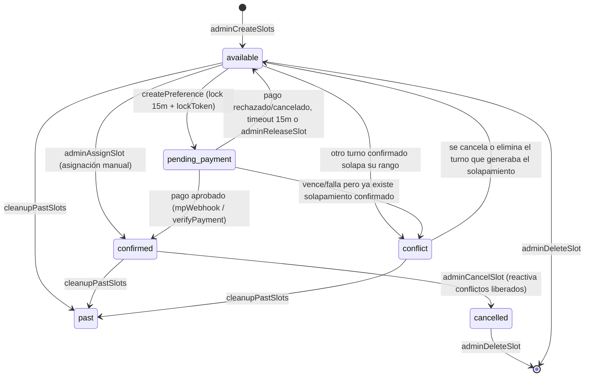
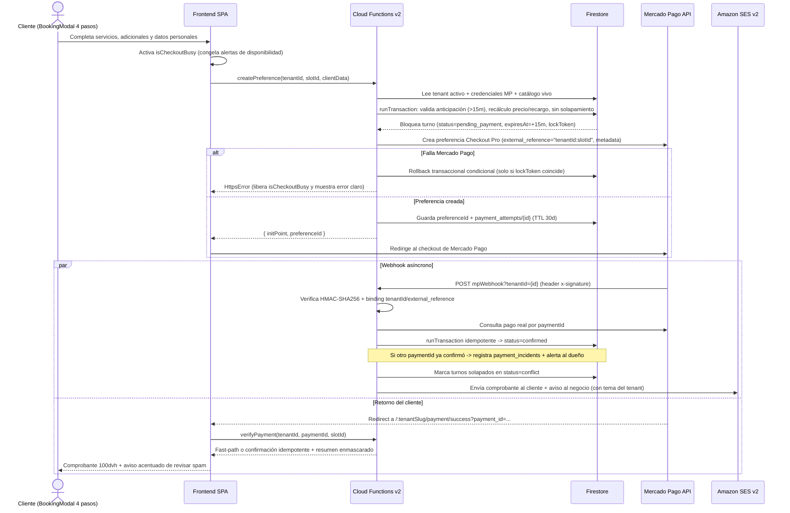

# Turneado — Arquitectura del Sistema y Registro de Decisiones Arquitectónicas (ADRs)

> **Documento maestro de arquitectura** · Actualizado a la implementación vigente en `main` (Specs `00` a `15` + endurecimientos recientes de UX y Checkout).  
> **Alcance:** Arquitectura integral de frontend, backend serverless, modelo de datos multi-tenant, seguridad Zero-Trust, operaciones y decisiones arquitectónicas formales (`ADR-001` a `ADR-014`).

---

## 1. Contexto del Sistema y Alcance

**Turneado** es una plataforma **SaaS Multi-Tenant** de reservas online con cobro de seña directa, personalización de identidad visual (web y correos transaccionales) y autogestión operativa para negocios de servicios que atienden por turnos (estudios de estética, barberías, spa/bienestar, consultorios, kinesiología/pilates, estudios profesionales y oficios independientes).

### 1.1 Actores y Roles

| Actor / Rol | Superficie principal | Mecanismo de acceso | Responsabilidades |
| :--- | :--- | :--- | :--- |
| **Visitante / Cliente final** | `/`, `/ayuda`, `/:tenantSlug`, `/prices`, `/about`, `/payment/*` | Anónimo (sin registro ni login) | Explora agenda pública, calcula presupuestos, reserva en 4 pasos, abona seña vía Mercado Pago y recibe comprobante por email. |
| **Staff del negocio (`staff`)** | `/:tenantSlug/admin` | Firebase Auth + Custom Claim `tenants[tenantId] = 'staff'` (con fallback a `/members/{uid}`) | Opera agenda confirmada, gestión/creación/asignación/cancelación/liberación de turnos. Sin acceso a precios, perfil, apariencia, métricas ni cobros. |
| **Dueño del negocio (`owner`)** | `/:tenantSlug/admin` | Firebase Auth + Custom Claim `tenants[tenantId] = 'owner'` (con fallback a `/members/{uid}`) | Acceso completo a su tenant: agenda, turnos, servicios/extras, métricas, Estudio de Apariencia, perfil/branding, portfolio, Difusión (Instagram + QR) y credenciales de Mercado Pago. |
| **Platform Admin (`platformAdmin`)** | `/superadmin` + acceso de soporte a cualquier tenant | Firebase Auth + Custom Claim `platformAdmin: true` (asignado vía CLI) | Alta atómica de negocios, pausa/reactivación, cambio de slug con redirección, gestión de miembros y diagnóstico operativo. |

### 1.2 Stack Tecnológico Verificado

| Capa | Tecnologías y versiones |
| :--- | :--- |
| **Frontend SPA** | React `19.2`, TypeScript `~6.0`, Vite `8.2`, React Router `7.18`, `motion` `13.3`, `lucide-react` `1.37`, `qrcode` `1.5`, CSS Modules + CSS Custom Properties (`variables.css`). |
| **Hosting & Auth** | Firebase Hosting (SPA rewrite + cache inmutable en `/assets/**`), Firebase Authentication (Email/Password + Custom Claims). |
| **Datos & Medios** | Cloud Firestore (arquitectura multi-tenant + índices compuestos + TTL nativo), Cloud Storage for Firebase (aislado por `/tenants/{tenantId}/{folder}/*`). |
| **Backend Serverless** | Cloud Functions v2 sobre Node.js `24` (`firebase-functions` `6.3`, `firebase-admin` `13.1`, TypeScript `5.7`), Cloud Scheduler. |
| **Pagos & Correos** | Mercado Pago SDK `2.3` (Checkout Pro + Webhooks con verificación HMAC-SHA256), Amazon SES v2 (`@aws-sdk/client-sesv2` `3.1178`). |
| **Testing & Operaciones** | Vitest `4.1` (`28` suites unitarias / `297` tests + `14` suites de integración con Firebase Emulators), CLI Node ESM (`scripts/turneado-cli.mjs`, `scripts/cli/console.mjs`), sincronizador oficial de feriados (`scripts/sync-holidays.mjs`). |

---

## 2. Arquitectura de Alto Nivel

```mermaid
flowchart TD
    subgraph Client["Navegador del Usuario (React 19 SPA — Firebase Hosting)"]
        LP["Landing (/) y Ayuda (/ayuda)"]
        PUB["Storefront Público (/:tenantSlug, /prices, /about, /payment/*)"]
        ADM["Backoffice Negocio (/:tenantSlug/admin)"]
        SUP["Panel Plataforma (/superadmin)"]
    end

    subgraph Auth["Firebase Authentication"]
        JWT["ID Token + Custom Claims (platformAdmin, tenants map)"]
    end

    subgraph Firestore["Cloud Firestore (Zero-Trust Rules)"]
        SLUGS["/tenant_slugs/{slug} (Bootstrap 1-read + redirects)"]
        META["/tenants/{id}/public_meta/availability (Proyección libre de PII)"]
        PUBDATA["/tenants/{id}/{ownerinfo,services,portfolio}"]
        PRIVDATA["/tenants/{id}/{slots,members,payment_incidents}"]
        BACKENDONLY["/tenants/{id}/{private_config,payment_attempts}"]
    end

    subgraph Storage["Firebase Storage"]
        ASSETS["/tenants/{id}/{logo,profile,hero,portfolio}/*"]
    end

    subgraph Functions["Cloud Functions v2 (Node 24 — Admin SDK)"]
        PAYFN["Pagos: createPreference, verifyPayment, mpWebhook"]
        ADMFN["Turnos Admin: Create, Assign, Cancel, Release, Delete + PaymentSettings"]
        SUPFN["SuperAdmin: CreateTenant, UpdateTenant, ChangeSlug, UpsertMember"]
        TRIG["Triggers: syncPublicSlot, onTenantDoc/OwnerInfo/MemberWritten"]
        CRON["Cloud Scheduler: releaseExpiredSlots (10m), cleanupPastSlots (horario)"]
    end

    subgraph External["Servicios Externos"]
        MP["Mercado Pago API (por cuenta del tenant)"]
        SES["Amazon SES v2 (noreply@turneado.app)"]
    end

    PUB -->|"1 lectura bootstrap"| SLUGS
    PUB -->|"onSnapshot libre de PII"| META
    PUB -->|"lectura + caché local"| PUBDATA
    PUB -->|"onCall"| PAYFN

    ADM -->|"Auth + claims"| JWT
    ADM -->|"lectura slots / escritura perfil, servicios, portfolio"| PRIVDATA
    ADM -->|"subida <=5MB"| ASSETS
    ADM -->|"onCall RBAC"| ADMFN

    SUP -->|"Auth platformAdmin"| JWT
    SUP -->|"onCall"| SUPFN

    PAYFN -->|"runTransaction + lock 15m"| PRIVDATA
    PAYFN -->|"credenciales tenant"| BACKENDONLY
    PAYFN -->|"Preferences / Payments API"| MP
    MP -->|"Webhook + HMAC x-signature"| PAYFN
    PAYFN -->|"comprobante / alertas"| SES

    ADMFN --> PRIVDATA
    ADMFN --> BACKENDONLY
    SUPFN --> PRIVDATA
    SUPFN --> SLUGS
    SUPFN --> JWT

    PRIVDATA -.->|"onDocumentWritten"| TRIG
    TRIG -->|"sync proyección"| META
    TRIG -->|"sync bootstrap / claims"| SLUGS
    TRIG -->|"sync claims"| JWT
    CRON -->|"collectionGroup agrupado por tenant"| PRIVDATA
    CRON -->|"reintento emails"| SES
```



---

## 3. Modelo Multi-Tenant, Datos y Reglas de Seguridad

### 3.1 Jerarquía de Colecciones en Firestore

El aislamiento lógico se estructura mediante un índice raíz de slugs públicos y subcolecciones estrictamente encapsuladas bajo `/tenants/{tenantId}` (con identificador validado por `^tnt_[a-z0-9]{4,32}$` y slugs validados por `^[a-z0-9]+(?:-[a-z0-9]+)*$` de 3 a 40 caracteres, excluyendo 21 slugs reservados como `admin`, `superadmin`, `ayuda`, `help`, `artifacts`, `payment`, etc.).

```text
/tenant_slugs/{slug}                       # Bootstrap público en 1 lectura (o alias redirectToSlug)
/tenants/{tenantId}                        # Metadatos del negocio (status, slug, timezone, currency, isDemo, mpConfigured)
├── /members/{uid}                         # Membresías { role: 'owner'|'staff', active: boolean, email }
├── /private_config/integrations           # Backend-only: mpAccessToken, mpWebhookSecret (sin acceso cliente)
├── /public_meta/availability              # Proyección pública agregada de turnos futuros/activos SIN PII
├── /ownerinfo/profile                     # Perfil comercial, redes, ubicación, imágenes y `appearance` (31 campos)
├── /services/{serviceId}                  # Catálogo de servicios, duración, precio base y adicionales (extras)
├── /portfolio/{workId}                    # Galería de trabajos del negocio
├── /slots/{slotId}                        # Fuente autoritativa de turnos (incluye clientData/PII y estado de pago/email)
├── /payment_attempts/{attemptId}          # Snapshot temporal de intentos de checkout (TTL nativo 30 días en `expireAt`)
└── /payment_incidents/{paymentId}         # Registro de doble pago o conflicto por pago tardío para auditoría del owner
```

### 3.2 Matriz de Acceso (`firestore.rules` y `storage.rules`)

Toda ruta fuera de las reglas explícitas cae en `allow read, write: if false;` (*default-deny*).

| Ruta | Lectura (`get` / `list`) | Escritura | Justificación de seguridad |
| :--- | :--- | :--- | :--- |
| `/tenant_slugs/{slug}` | `get`: público · `list`: denegado | Denegada (solo Triggers / Admin SDK) | Evita enumeración de clientes de la plataforma y resuelve bootstrap en 1 lectura. |
| `/tenants/{tenantId}` | `get`: si `status == 'active'` o miembro · `list`: solo `platformAdmin` | Denegada (solo Admin SDK) | Protege el catálogo de tenants y evita mutaciones de estado o `isDemo` desde cliente. |
| `/tenants/{id}/members/{uid}` | `get`: propio usuario u `owner` · `list`: `owner` | Denegada (solo `superadminUpsertTenantMember`) | Evita escalación de privilegios en el tenant. |
| `/tenants/{id}/private_config/{doc}` | Denegada | Denegada | Credenciales sensibles de Mercado Pago jamás salen del servidor. |
| `/tenants/{id}/public_meta/availability` | `get`: público · `list`: denegado | Denegada (solo trigger `syncPublicSlot`) | Expone agenda reactiva al cliente sin PII y en un documento compacto. |
| `/tenants/{id}/ownerinfo/profile` | `get`: público · `list`: denegado | `owner` | Permite editar marca, contacto y Apariencia directamente desde el backoffice. |
| `/tenants/{id}/services/{id}` y `portfolio/{id}` | `read`: público | `owner` | Catálogo público de lectura rápida; edición restringida al dueño. |
| `/tenants/{id}/slots/{slotId}` | `read`: `owner` o `staff` | Denegada (solo Cloud Functions) | Contiene PII del cliente y estados financieros; toda mutación pasa por validación transaccional en backend. |
| `/tenants/{id}/payment_attempts/{id}` | Denegada | Denegada | Uso interno exclusivo para recuperación de metadata en pagos tardíos. |
| `/tenants/{id}/payment_incidents/{id}` | `read`: `owner` | Denegada | Auditoría de incidentes de pago sin posibilidad de alteración manual. |
| **Storage** `/tenants/{id}/{logo\|profile\|hero\|portfolio}/{file}` | `read`: público | `create/update/delete`: solo `owner`, ≤ 5 MB, JPEG/PNG/WebP (+ SVG solo en `logo`) | Aislamiento físico por carpeta de tenant y prevención de XSS por SVG en carpetas no permitidas. |

### 3.3 Índices Compuestos y TTL (`firestore.indexes.json`)

- **Colección `slots` (`COLLECTION`):** `(status ASC, datetime ASC)` y `(status ASC, expiresAt ASC)` para detección transaccional de conflictos en ventanas temporales.
- **Grupo de colecciones `slots` (`COLLECTION_GROUP`):** `(status ASC, expiresAt ASC)`, `(emailStatus ASC, updatedAt ASC)` y `(status ASC, datetime ASC)` para los crons multi-tenant.
- **Colección `payment_attempts` (`COLLECTION`):** `(slotId ASC, createdAt DESC)` + política **TTL nativa** sobre el campo `expireAt` (30 días de retención automática).

---

## 4. Arquitectura Backend (Cloud Functions v2)

El backend en `functions/src/` (19 módulos TypeScript) expone exactamente **20 Cloud Functions v2** (Node 24, `256MiB`, límites explícitos de concurrencia):

### 4.1 Catálogo Completo de Funciones Exportadas

| Grupo | Función | Tipo / Trigger | Autorización | Responsabilidad principal |
| :--- | :--- | :--- | :--- | :--- |
| **Checkout y Pagos** | `createPreference` | `onCall` | Pública (tenant activo) | Valida payload contra catálogo vivo y recargo del turno, bloquea el turno por 15 min (`lockToken`) en transacción, crea preferencia MP del tenant, registra `payment_attempts` y revierte condicionalmente si MP falla. |
| | `mpWebhook` | `onRequest` (HTTP) | Query `?tenantId=` + HMAC `x-signature` + tenant binding | Recibe notificaciones de Mercado Pago, verifica firma criptográfica contra el secreto del tenant y ejecuta `processPaymentConfirmation`. |
| | `verifyPayment` | `onCall` | Pública (por `tenantId` + `paymentId`) | Fast-path si el webhook ya confirmó y envió correos; si no, consulta MP con credenciales del tenant, confirma idempotentemente y retorna detalle enmascarado (`maskedClientEmail`). |
| **Turnos Admin** | `adminCreateSlots` | `onCall` | `owner` / `staff` | Creación individual o masiva con validación de duplicados, zona horaria, recargos (`fixed`/`percentage`) y detección de conflictos iniciales. |
| | `adminAssignSlot` | `onCall` | `owner` / `staff` | Asignación manual de cliente con recálculo de duración/precio/recargo y marcado automático de turnos solapados en `conflict`. |
| | `adminCancelSlot` | `onCall` | `owner` / `staff` | Cancela un turno confirmado y reactiva automáticamente turnos adyacentes en `conflict` que ya no colisionen. |
| | `adminReleaseSlot` | `onCall` | `owner` / `staff` | Libera bloqueos `pending_payment` o devuelve un turno a `available` (o `conflict` si existe solapamiento). |
| | `adminDeleteSlot` | `onCall` | `owner` / `staff` | Elimina turnos no confirmados y recalcula conflictos si corresponde. |
| **Cobros Tenant** | `adminGetPaymentSettingsSummary` | `onCall` | `owner` | Devuelve estado de configuración, token enmascarado (`APP_USR-...1234`), modo (producción/prueba) y URL del webhook del tenant. |
| | `adminSavePaymentSettings` | `onCall` | `owner` | Valida y guarda/elimina credenciales MP en `private_config/integrations` y sincroniza la bandera pública `mpConfigured`. |
| **SuperAdmin** | `superadminCreateTenant` | `onCall` | `platformAdmin` | Alta atómica de tenant, slug público, usuario/membresía inicial `owner`, perfil inicial y sync de claims. |
| | `superadminUpdateTenant` | `onCall` | `platformAdmin` | Actualiza metadatos, estado (`active` / `suspended`), zona horaria y bandera `isDemo`. |
| | `superadminChangeTenantSlug` | `onCall` | `platformAdmin` | Migra el slug principal preservando el slug anterior como documento de redirección (`redirectToSlug`). |
| | `superadminUpsertTenantMember` | `onCall` | `platformAdmin` | Agrega, promueve (`staff` ↔ `owner`), revoca o reactiva miembros del tenant en Firestore y Auth. |
| **Triggers Sync** | `syncPublicSlot` | `onDocumentWritten` (`slots/{slotId}`) | Interno | Mantiene `/public_meta/availability` actualizado en tiempo real con proyección compacta sin PII (con reintentos ante códigos transitorios). |
| | `onTenantDocWritten` | `onDocumentWritten` (`tenants/{id}`) | Interno | Sincroniza metadatos públicos del tenant en `/tenant_slugs/{slug}`. |
| | `onTenantOwnerInfoWritten` | `onDocumentWritten` (`ownerinfo/profile`) | Interno | Sincroniza perfil comercial y `appearance` sanitizada en `/tenant_slugs/{slug}` para bootstrap instantáneo. |
| | `onTenantMemberWritten` | `onDocumentWritten` (`members/{uid}`) | Interno | Recalcula Custom Claims `tenants` en Firebase Auth verificando el límite de tamaño de JWT (`950 bytes`). |
| **Crons** | `releaseExpiredSlots` | `onSchedule` (`every 10 minutes`) | Cloud Scheduler | Libera bloqueos `pending_payment` expirados (>15 min) agrupados por `tenantId` y reintenta hasta 3 veces correos en estado `failed`/`partial`/atascados (>2 min). |
| | `cleanupPastSlots` | `onSchedule` (`0 0,8-23 * * *`) | Cloud Scheduler | Marca turnos pasados como `past` y depura turnos libres vencidos respetando el aislamiento por `tenantId`. |

### 4.2 Ciclo de Vida de un Turno



### 4.3 Flujo Transaccional de Reserva, Pago e Idempotencia



---

## 5. Arquitectura Frontend (React 19 SPA)

### 5.1 Mapa de Rutas y Code Splitting (`src/App.tsx`)

- **Rutas globales de plataforma:**
  - `/` → `LandingView` (lazy): landing comercial de Turneado con acceso a demo y dossier.
  - `/ayuda` (`/help` → redirect a `/ayuda`) → `HelpView` (lazy): centro de ayuda con buscador instantáneo (`helpSearch.ts`).
  - `/superadmin/login` y `/superadmin` → `SuperAdminLogin` / `PlatformProtectedRoute` → `SuperAdminLayout` → `SuperAdminView` (lazy).
- **Rutas aisladas por negocio (`/:tenantSlug` → `TenantShell`):**
  - `/:tenantSlug` → `ClientView` (eager para LCP rápido).
  - `/:tenantSlug/prices` y `/:tenantSlug/about` → `Prices` y `About` (lazy) bajo `ClientLayout`.
  - `/:tenantSlug/payment/success`, `payment/pending`, `payment/failure` → `PaymentSuccess` / `PaymentFailure` (lazy) bajo `ClientLayout showNavbar={false}` (`100dvh` centrado, tematizado con identidad del tenant).
  - `/:tenantSlug/login` → `Login` (lazy) bajo `LoginLayout`.
  - `/:tenantSlug/admin` → `ProtectedTenantRoute` → `AdminLayout` → `AdminView` (lazy).

### 5.2 Árbol de Providers y Aislamiento de Estado

```text
ThemeProvider
└── AuthProvider (session + Custom Claims + refresh)
    └── TenantProvider (1-read /tenant_slugs/{slug}, redirect alias, status active/suspended/not_found)
        └── TenantDataProviders
            ├── OwnerInfoProvider   (key="owner-{tenantId}")
            ├── TenantThemeApplier  (inyecta variables CSS + sincroniza caché localStorage por slug)
            ├── ServicesProvider    (key="services-{tenantId}")
            └── PortfolioProvider   (key="portfolio-{tenantId}")
                └── Suspense (inner fallback para no desmontar providers al navegar entre vistas lazy)
```

- **Aislamiento de caché (`publicCache.ts`):** Todas las claves de caché local incorporan `tenantId` (o `slug` para apariencia) evitando contaminación visual o de datos al cambiar de `/demo` a otro negocio.

### 5.3 Motor de Apariencia v2 (`themeEngine.ts` + `themePresets.ts`)

- **31 campos configurables** (`TenantAppearanceConfig`): **24 paletas curadas** en 6 categorías, colores primario/acento/fondo en HEX libre con **calibración automática de contraste WCAG AA** tanto en modo claro como oscuro, **5 Style Packs por rubro** (`nail-lash-atelier`, `barber-classic`, `spa-botanical`, `clinical-studio`, `urban-minimal`), **6 temperaturas de superficie**, **6 fondos/texturas** en 3 intensidades, **8 pares tipográficos**, **4 curvaturas**, **4 estilos de superficie** (`bordered`, `elevated`, `flat`, `glass` con opacidades legibles y tokens `--bg-surface-solid`), **3 estilos de botón**, **3 densidades**, **3 escalas de texto**, **5 layouts de Hero**, **6 formas y 6 marcos de imagen** con matriz de compatibilidad (`HERO_FRAME_ALLOWED_SHAPES`), **8 presets de copy**, navbar, forma de logo, portfolio, tarjetas de turno y movimiento.
- **Aislamiento de backoffice:** En `/:tenantSlug/admin`, `TenantThemeApplier` desactiva el skin del storefront para garantizar legibilidad operativa uniforme, manteniendo el preview en vivo (desktop, mobile flotante y email sincronizado) dentro de `AppearanceSettings`.
- **Consistencia en pantallas de retorno y estado:** La caché por slug (`turneado_appearance_cache:{slug}`) aplica el tema y branding del negocio incluso en `PaymentSuccess`, `PaymentFailure` y `TenantSuspended` antes de completar lecturas remotas.

### 5.4 Única Fuente de Verdad para Fechas y Feriados (`dateUtils.ts` + `holidays.ts`)

- Todas las conversiones de día de negocio (`YYYY-MM-DD`), etiquetas de rango (`Día / Semana / Mes / Todos`) y validaciones de anticipación operan en la zona horaria IANA del tenant (`America/Argentina/Buenos_Aires` por defecto), evitando corrimientos por timezone del dispositivo del visitante.
- Los feriados nacionales argentinos se consumen desde `src/data/holidays.json` (sincronizable con `npm run holidays:sync` desde `argentina.gob.ar`) con búsqueda `O(1)` por `Map` y reflejo en el selector de fechas de `ClientView`, `AdminView` y `CreateSlotModal`.

### 5.5 Pasarela de Reserva en 4 Pasos (`BookingModal` + `bookingWizard.ts`)

- Modal unificado en `ClientView` (desktop `560px × min(86dvh, 680px)`, mobile `88dvh`) con **4 pasos** (`Servicios` → `Adicionales` → `Tus datos` → `Resumen y pago`), auto-salto inteligente del Paso 2 cuando los servicios elegidos no tienen adicionales, barra de progreso híbrida en vivo (`computeBookingWizardProgress`), persistencia local de datos de contacto del cliente, y fallback a WhatsApp/Instagram cuando `!mpConfigured`.
- **Protección de estados en vuelo:** Durante el envío y redirección a Mercado Pago (`isCheckoutBusy`), el modal congela las alertas reactivas (`isSlotUnavailable`, `hasLiveDurationConflict`) que dispararía el propio bloqueo `pending_payment` al propagarse por `onSnapshot`, y escucha el evento `pageshow` (`bfcache`) para cerrarse limpiamente si el usuario presiona "Atrás" desde la pasarela.

### 5.6 Backoffice (`AdminView`) y Difusión Client-Side (`DiffusionHub`)

- Navegación en **3 grupos semánticos**: *Gestión diaria* (`Agenda`, `Turnos`, `Servicios`, `Métricas`), *Tu página pública* (`Apariencia`, `Mi Perfil`, `Portfolio`, `Difusión y QR`) y *Configuración avanzada* (`Mercado Pago`, protegido por confirmación y bloqueo de edición por defecto).
- `DiffusionHub` reúne dos herramientas 100% client-side que reutilizan la apariencia real del negocio (`canvasAppearance.ts`):
  1. **Placa PNG de Turnos para Instagram** (`InstagramScheduleGenerator` + `instagramScheduleCanvas.ts`): renderiza en `<canvas>` 2D una placa 1080×1920 con turnos libres filtrables y descarga directa.
  2. **Tarjeta de Negocio y QR** (`BusinessCardGenerator` + `qrGenerator.ts`): genera tarjeta visual y código QR hacia `/:tenantSlug` listos para descargar o imprimir.

---

## 6. Invariantes de Seguridad y Zero-Trust

1. **Cero escritura directa de turnos desde el cliente:** `/tenants/{id}/slots` tiene `allow write: if false`. Toda mutación pasa por Cloud Functions con validación de rol, horario y colisiones.
2. **Cero exposición de PII al público:** `/slots` solo es legible por miembros autenticados; el cliente público lee exclusivamente `/public_meta/availability`, cuya proyección elimina nombre, email, teléfono, notas, `paymentId` y `lockToken`.
3. **Aislamiento de secretos de cobro:** `/private_config/integrations` tiene `allow read, write: if false`. El frontend solo recibe un resumen enmascarado vía `adminGetPaymentSettingsSummary`.
4. **Barrera estricta de Modo Demo:** El respaldo de variables de entorno (`MP_ACCESS_TOKEN`, `MP_WEBHOOK_SECRET`, `BUSINESS_EMAIL`) solo se habilita cuando `tenant.isDemo === true`. Un negocio comercial sin credenciales propias rechaza pagos de forma controlada y nunca cobra en la cuenta de otro negocio ni en la demo.
5. **Vinculación estricta de Webhook (`tenantId` + HMAC):** `mpWebhook` exige `?tenantId=`, verifica la firma `x-signature` contra el secreto de ese tenant y valida que `metadata.tenant_id` y `external_reference` (`tenantId:slotId`) coincidan antes de confirmar.
6. **Autorización híbrida sin fricción:** Tanto `firestore.rules` como `assertTenantRole` validan Custom Claims del JWT y hacen fallback automático a `/tenants/{id}/members/{uid}` cuando un claim recién emitido aún no refrescó en el token.
7. **Recálculo autoritativo en servidor:** `createPreference` y `adminAssignSlot` ignoran precios/duraciones enviados por el cliente y recalculan totales, adicionales y recargos (`fixed` / `percentage`) desde el catálogo vivo en Firestore y el documento real del turno.
8. **Idempotencia e incidentes de pago auditados:** Si llega un segundo pago aprobado sobre un turno ya confirmado por otro `paymentId` o en conflicto tardío, nunca se sobrescribe la reserva vigente: se persiste en `/payment_incidents/{paymentId}` y se alerta al dueño por email.
9. **Crons particionados por `tenantId`:** `processExpiredSlots` y `cleanupPastSlots` consultan por `collectionGroup('slots')` pero agrupan estrictamente por `tenantId` antes de evaluar ventanas de conflicto, impidiendo interferencias entre negocios.
10. **Aislamiento físico en Storage:** Cada negocio solo puede escribir bajo `/tenants/{tenantId}/{logo|profile|hero|portfolio}/` con límite de 5 MB y lista blanca de MIME (SVG restringido únicamente a `logo`).

---

## 7. Operaciones, Automatización y Estrategia de Testing

- **Desarrollo local unificado:** `npm run dev:local` compila Functions, levanta emuladores (`Auth:9099`, `Firestore:8080`, `Storage:9199`, `Functions:5001`, `UI:4000`) con importación/exportación en `.firebase/emulator-data`, ejecuta seed idempotente (`/demo` + SuperAdmin local) y arranca Vite en modo emulador.
- **CLI Operativa (`scripts/turneado-cli.mjs`) y Consola Interactiva (`scripts/cli/console.mjs`):** Comandos `doctor`, `reset` (con guardrails y `--dry-run`), `init`, `admin <promote|revoke>`, `tenant <list|inspect|delete>` y `backup export`, accesibles también desde el menú interactivo `npm run cli:console` o el lanzador Windows `scripts/quickactions/turneado-quickactions.bat`.
- **Artefactos comerciales reproducibles:** `artifacts/src/build.mjs` (`npm run artifacts:build|cards|pdf`) genera tarjetas y dossier comercial A4 en `public/artifacts/` a partir de tokens y copy desacoplados.
- **Cobertura automatizada verificada:**
  - **Unitarios (`npm test`):** `28` suites / `297` tests en `tests/unit/` cubriendo motor de conflictos, recargos, fechas/timezone, feriados, wizard de 4 pasos, motor de apariencia, analíticas, timeline de agenda, validación de checkout, webhook HMAC, correos SES, CLI operativa y consola interactiva.
  - **Integración (`npm run test:integration`):** `14` suites en `tests/integration/` sobre Firebase Emulators certificando reglas Firestore/Storage, aislamiento cross-tenant, triggers de proyección/claims, crons, pagos/incidentes y ciclo de vida SuperAdmin.

---

## 8. Registro de Decisiones Arquitectónicas (ADRs)

| ID | Decisión | Estado |
| :--- | :--- | :--- |
| [ADR-001](#adr-001-multi-tenancy-lógico-en-un-único-proyecto-firebase) | Multi-tenancy lógico en un único proyecto Firebase (`/:tenantSlug` + `/tenants/{id}`) | Aceptada |
| [ADR-002](#adr-002-bootstrap-público-en-1-lectura-vía-tenant_slugsslug-y-aliases) | Bootstrap público en 1 lectura vía `/tenant_slugs/{slug}` y aliases de redirección | Aceptada |
| [ADR-003](#adr-003-proyección-pública-agregada-libre-de-pii-public_metaavailability) | Proyección pública agregada libre de PII (`/public_meta/availability`) | Aceptada |
| [ADR-004](#adr-004-mutación-exclusiva-de-turnos-vía-cloud-functions-y-bloqueo-transaccional) | Mutación exclusiva de turnos vía Cloud Functions y bloqueo transaccional (15 min) | Aceptada |
| [ADR-005](#adr-005-recálculo-autoritativo-de-precios-duraciones-y-recargos-en-servidor) | Recálculo autoritativo de precios, duraciones y recargos en servidor | Aceptada |
| [ADR-006](#adr-006-cobro-directo-en-mercado-pago-por-tenant-con-hmac-y-tenant-binding) | Cobro directo en Mercado Pago por tenant con HMAC y tenant binding | Aceptada |
| [ADR-007](#adr-007-rbac-híbrido-con-custom-claims-y-fallback-a-documento-de-membresía) | RBAC híbrido con Custom Claims y fallback a `/members/{uid}` | Aceptada |
| [ADR-008](#adr-008-correos-transaccionales-en-amazon-ses-v2-con-tematización-espejo) | Correos transaccionales en Amazon SES v2 con tematización espejo y reintentos | Aceptada |
| [ADR-009](#adr-009-motor-de-apariencia-v2-con-calibración-wcag-aa-y-caché-por-slug) | Motor de Apariencia v2 con calibración WCAG AA y caché por slug | Aceptada |
| [ADR-010](#adr-010-única-fuente-de-verdad-para-fechas-y-feriados-estáticos-sincronizables) | Única fuente de verdad para fechas (`dateUtils.ts`) y feriados sincronizables | Aceptada |
| [ADR-011](#adr-011-pasarela-de-reserva-en-modal-wizard-de-4-pasos-con-protección-bfcache) | Pasarela de reserva en modal wizard de 4 pasos con protección `bfcache` | Aceptada |
| [ADR-012](#adr-012-generación-de-placas-instagram-y-tarjetas-qr-100-client-side) | Generación de placas PNG de Instagram y tarjetas QR 100% client-side | Aceptada |
| [ADR-013](#adr-013-mantenimiento-server-side-por-collectiongroup-agrupado-y-ttl-nativo) | Mantenimiento por `collectionGroup` agrupado por tenant y TTL nativo | Aceptada |
| [ADR-014](#adr-014-cli-operativa-unificada-consola-interactiva-y-emuladores-persistentes) | CLI operativa unificada, consola interactiva y emuladores con persistencia | Aceptada |

---

### ADR-001: Multi-Tenancy Lógico en un Único Proyecto Firebase
- **Estado:** Aceptada (Specs `00`–`06`).
- **Contexto:** Escalar Turneado de un negocio único a decenas/cientos de negocios independientes sin multiplicar despliegues, certificados SSL ni costos fijos de infraestructura por cliente.
- **Decisión:** Operar todos los negocios sobre un único proyecto Firebase usando enrutamiento por path (`/:tenantSlug/*`) y particionamiento jerárquico estricto en Firestore (`/tenants/{tenantId}/*`) y Storage (`/tenants/{tenantId}/*`), desacoplando el `tenantId` inmutable (`tnt_*`) del `slug` mutable en URL.
- **Alternativas descartadas:** (a) Un proyecto Firebase por cliente (inviable operativamente al desplegar reglas/functions); (b) Subdominios wildcard `*.turneado.app` desde día uno (agrega complejidad de DNS/certificados y gestión de cookies/origin sin valor inmediato para links de Instagram/WhatsApp).
- **Consecuencias:** Despliegues atómicos y costo marginal casi nulo por nuevo tenant; exige disciplina absoluta en reglas de seguridad, `tenantId` explícito en toda Cloud Function y suite de certificación cross-tenant.

### ADR-002: Bootstrap Público en 1 Lectura vía `/tenant_slugs/{slug}` y Aliases
- **Estado:** Aceptada (Specs `01`, `03`, `05`).
- **Contexto:** Al cargar `/:tenantSlug`, el frontend necesita resolver `tenantId`, estado (`active`/`suspended`), zona horaria, apariencia y perfil básico con latencia mínima y sin permitir listar qué otros negocios existen en la plataforma.
- **Decisión:** Mantener una colección raíz `/tenant_slugs/{slug}` con `allow get: if true; allow list: if false`, sincronizada automáticamente por triggers (`onTenantDocWritten`, `onTenantOwnerInfoWritten`). Cuando un negocio cambia de slug (`superadminChangeTenantSlug`), el slug anterior permanece como documento alias con `redirectToSlug`.
- **Alternativas descartadas:** Consultar `tenants.where('slug', '==', slug)` desde el cliente (requeriría habilitar `list` sobre `/tenants`, exponiendo enumeración y obligando a lecturas adicionales para `ownerinfo`).
- **Consecuencias:** Arranque público rápido en 1 lectura y cambios de nombre comercial sin romper enlaces ya impresos en tarjetas QR o bios de Instagram; introduce consistencia eventual leve mitigada por sincronización directa en triggers.

### ADR-003: Proyección Pública Agregada Libre de PII (`/public_meta/availability`)
- **Estado:** Aceptada (Specs `01`, `02`, `03`).
- **Contexto:** `ClientView` necesita disponibilidad en tiempo real (incluyendo bloqueos y solapamientos) para decenas de turnos futuros, pero los documentos reales en `/slots` contienen PII de clientes y datos de pago.
- **Decisión:** Denegar lectura pública de `/slots` y mantener un documento agregado `/tenants/{id}/public_meta/availability` actualizado por el trigger `syncPublicSlot` con solo los campos necesarios de turnos `available`, `pending_payment` y `confirmed` (excluyendo toda PII y turnos `past`/`cancelled`/`conflict`).
- **Alternativas descartadas:** (a) Abrir lectura de `/slots` filtrando campos en cliente (vulnerabilidad crítica de fuga de PII); (b) Subcolección pública de 1 documento por slot (multiplica por N el costo de lecturas Firestore por cada visita).
- **Consecuencias:** 1 lectura por visita + actualizaciones `onSnapshot` económicas y garantía estructural de cero PII pública; requiere mantener compacto el payload de cada slot dentro del límite de 1 MiB por documento de Firestore (mitigado por `cleanupPastSlots` y `compactPublicServices`).

### ADR-004: Mutación Exclusiva de Turnos vía Cloud Functions y Bloqueo Transaccional
- **Estado:** Aceptada (Specs `01`, `02`, `04`).
- **Contexto:** El problema central del dominio es evitar *double booking* bajo concurrencia (dos clientes intentando pagar el mismo turno o turnos solapados por duración variable).
- **Decisión:** Prohibir escrituras directas sobre `/slots` en `firestore.rules`. `createPreference` ejecuta una transacción Firestore (`runTransaction`) que valida anticipación mínima (15 min), conflictos por intervalo y bloquea el turno por 15 min con un `lockToken` UUID único. Se guarda además un snapshot en `/payment_attempts/{id}` para recuperar datos si un pago se aprueba tras vencer el bloqueo; si Mercado Pago falla, se hace rollback solo si el `lockToken` sigue vigente.
- **Alternativas descartadas:** Escritura optimista desde el navegador del cliente (manipulable y sujeta a condiciones de carrera sin autoridad de pago).
- **Consecuencias:** Garantía fuerte contra solapamientos y doble confirmación; requiere conectividad con Functions/emulador para cualquier escritura de agenda.

### ADR-005: Recálculo Autoritativo de Precios, Duraciones y Recargos en Servidor
- **Estado:** Aceptada (Specs `02`, `12`).
- **Contexto:** El cliente selecciona servicios, adicionales opcionales y puede reservar turnos con recargo (`fixed` o `percentage`, por ejemplo feriados o horarios nocturnos). Confiar en los montos calculados por el navegador permitiría manipular totales o duraciones para burlar detección de conflictos.
- **Decisión:** `createPreference` y `adminAssignSlot` validan la selección contra el catálogo vivo del tenant (`getLiveServicesCatalogCached`) y el objeto `surcharge` almacenado en el documento del turno, recalculando autoritativamente `basePrice`, `extrasPrice`, `surchargeAmount`, `estimatedPrice`, `estimatedDurationMinutes` y `endDatetime`.
- **Alternativas descartadas:** Persistir directamente el total y duración calculados por `BookingModal`.
- **Consecuencias:** Integridad financiera y de agenda garantizada en servidor; requiere mantener sincronizada la lógica pura de cálculo (`src/utils/surcharge.ts` y `functions/src/surcharge.ts`) cubierta por tests unitarios.

### ADR-006: Cobro Directo en Mercado Pago por Tenant con HMAC y Tenant Binding
- **Estado:** Aceptada (Specs `02`, `04`).
- **Contexto:** Cada negocio necesita cobrar la seña directamente en su cuenta de Mercado Pago (0% comisión de intermediación de Turneado) sin compartir credenciales ni recibir webhooks falsificados o cruzados.
- **Decisión:** Almacenar `mpAccessToken` y `mpWebhookSecret` de cada negocio en `/tenants/{id}/private_config/integrations` (backend-only), configurar `notification_url` con `?tenantId={tenantId}`, verificar firma HMAC-SHA256 (`x-signature`) con el secreto del tenant y validar el binding estricto de `metadata.tenant_id` y `external_reference` (`tenantId:slotId`). El fallback a `.env` solo aplica cuando `isDemo === true`.
- **Alternativas descartadas:** Cuenta colectora única de la plataforma con liquidaciones manuales (carga fiscal, riesgo financiero y menor adopción comercial).
- **Consecuencias:** Autonomía financiera total del negocio y aislamiento fuerte entre cuentas; deja pendiente como endurecimiento planificado (`artifacts/todo/secrets-and-credentials-hardening.md`) el cifrado en reposo (KMS/AES-GCM) y migración de secretos globales a Secret Manager.

### ADR-007: RBAC Híbrido con Custom Claims y Fallback a Documento de Membresía
- **Estado:** Aceptada (Specs `01`, `04`, `05`).
- **Contexto:** Los Custom Claims en JWT de Firebase Auth permiten autorización sin lecturas adicionales en Firestore/Storage, pero tardan en propagarse hasta que el token se renueva y tienen límite duro de 1000 bytes.
- **Decisión:** Sincronizar automáticamente `/tenants/{id}/members/{uid}` hacia Custom Claims (`onTenantMemberWritten`, con guarda de `MAX_CUSTOM_CLAIMS_BYTES = 950`) y evaluar en `firestore.rules` y `assertTenantRole` primero el JWT (`hasTenantClaim`) con cortocircuito `||` hacia `hasActiveMemberDoc` cuando el claim todavía no se refrescó. En `/superadmin`, ofrecer además botón de "Refrescar permisos" (`getIdToken(true)`).
- **Alternativas descartadas:** (a) Solo Custom Claims (rompe UX tras alta o cambio de rol hasta relogueo); (b) Solo lectura de Firestore en cada regla (duplica lecturas y no funciona en Storage Rules).
- **Consecuencias:** Autorización rápida en el caso común y consistencia inmediata ante altas/cambios de rol; en Storage (que no lee Firestore) sigue dependiendo del claim actualizado.

### ADR-008: Correos Transaccionales en Amazon SES v2 con Tematización Espejo
- **Estado:** Aceptada (Spec `10`).
- **Contexto:** Enviar comprobantes confiables desde dominio propio (`noreply@turneado.app`) reflejando la identidad de cada negocio (nombre en remitente RFC 2047, paleta, logo y zona horaria) sin bloquear la confirmación del pago si falla el correo.
- **Decisión:** Integrar `@aws-sdk/client-sesv2` con remitente contextualizado `"{Negocio}" <noreply@turneado.app>`, espejo de resolución de paleta en `functions/src/tenantAppearance.ts`, persistencia del estado de entrega en el slot (`emailStatus: processing|sent|partial|failed`, `clientEmailSent`, `ownerEmailSent`, `emailAttempts`) y reintento automático idempotente hasta 3 veces desde `releaseExpiredSlots` (y desde `verifyPayment` si aplica).
- **Alternativas descartadas:** SMTP de terceros con cuotas estrictas o envío síncrono bloqueante que falle el webhook de Mercado Pago ante un error transitorio de red.
- **Consecuencias:** Alta entregabilidad, bajo costo unitario y cero pérdida silenciosa de comprobantes; requiere mantener sincronizada la sanitización de apariencia entre frontend y backend.

### ADR-009: Motor de Apariencia v2 con Calibración WCAG AA y Caché por Slug
- **Estado:** Aceptada (Specs `08`, `09` + endurecimiento de tema en vistas de retorno).
- **Contexto:** Cada negocio exige un storefront con personalidad propia (24 paletas, colores HEX libres, modo claro/oscuro, estilo `glass`, tipografías, portadas Hero) sin comprometer accesibilidad ni producir parpadeos de tema por defecto (FOUC) en vistas de retorno (`/payment/*`) o suspensión (`TenantSuspended`).
- **Decisión:** Implementar un motor determinista (`themeEngine.ts`) que calcula tokens CSS (`--primary`, `--bg-surface`, `--bg-surface-solid`, `--border-subtle`, etc.) con verificación/calibración automática de contraste WCAG AA, aísla el backoffice del skin público, y cachea el último `appearance` + branding por `slug` en `localStorage` para hidratar instantáneamente antes de resolver Firestore.
- **Alternativas descartadas:** Hojas de estilo estáticas por tema (no escalan a colores HEX libres ni 31 ejes de personalización) o runtime CSS-in-JS pesado.
- **Consecuencias:** Personalización rica sin sobrecarga de bundle, accesibilidad garantizada incluso con colores custom y continuidad de marca en todo el recorrido del cliente.

### ADR-010: Única Fuente de Verdad para Fechas y Feriados Estáticos Sincronizables
- **Estado:** Aceptada (Spec `11`).
- **Contexto:** Usar `new Date()` o `toISOString().slice(0, 10)` en el navegador genera desfases de día alrededor de la medianoche o cuando un cliente viaja/usa otra zona horaria. Además, los negocios argentinos necesitan distinguir feriados al cargar turnos y al mostrar la agenda.
- **Decisión:** Centralizar todo formateo, agrupación y cálculo de rangos en `src/utils/dateUtils.ts` parametrizado por la zona horaria IANA del tenant, y servir los feriados desde un JSON estático versionado (`src/data/holidays.json`) actualizado mediante `npm run holidays:sync` contra la fuente oficial de `argentina.gob.ar`.
- **Alternativas descartadas:** Consultar una API externa de feriados en runtime desde el navegador (latencia, caídas de terceros, CORS y dependencia de red).
- **Consecuencias:** Cero latencia, 100% determinista en tests y sin fallas externas; requiere ejecutar `npm run holidays:sync` al cambiar de año calendario.

### ADR-011: Pasarela de Reserva en Modal Wizard de 4 Pasos con Protección `bfcache`
- **Estado:** Aceptada (Spec `15` + endurecimiento de checkout/retorno).
- **Contexto:** El formulario monolítico original concentraba demasiada carga cognitiva en mobile y perdía claridad cuando un servicio no tenía adicionales. Además, durante la redirección a Mercado Pago, la suscripción `onSnapshot` devolvía el propio estado `pending_payment` provocando falsos mensajes de "turno tomado", y volver con el botón "Atrás" restauraba el modal desde `bfcache`.
- **Decisión:** Estructurar `BookingModal` como wizard de 4 pasos dentro del mismo modal (preservando scroll y filtros de `ClientView`), con salto automático del Paso 2 sin adicionales, barra de progreso híbrida en vivo (`bookingWizard.ts`), congelamiento de alertas de disponibilidad mientras `isCheckoutBusy === true` y cierre limpio en `pageshow` (`event.persisted`) al regresar desde Mercado Pago.
- **Alternativas descartadas:** Crear rutas URL independientes por cada paso (`/book/step-1`..`step-4`), que complicaban el manejo del historial, el botón Atrás y la recuperación de filtros de la agenda.
- **Consecuencias:** Mayor tasa de conversión percibida en mobile y eliminación de falsos errores visuales durante el handoff a Mercado Pago.

### ADR-012: Generación de Placas Instagram y Tarjetas QR 100% Client-Side
- **Estado:** Aceptada (Spec `14`).
- **Contexto:** Los negocios publican semanalmente sus turnos disponibles en historias de Instagram y comparten tarjetas con QR en mostrador o WhatsApp.
- **Decisión:** Generar las placas PNG 1080×1920 (`instagramScheduleCanvas.ts`) y tarjetas/QR (`BusinessCardGenerator` + `qrcode`) directamente en el navegador mediante `<canvas>` 2D, derivando colores y tipografía desde el `AppearanceSettings` real del tenant (`canvasAppearance.ts`).
- **Alternativas descartadas:** Renderizado server-side con Puppeteer/Sharp en Cloud Functions (costoso en memoria/cold start y más lento para previsualización interactiva).
- **Consecuencias:** Previsualización instantánea, cero costo de cómputo backend y descarga inmediata; depende de fuentes cargadas en el navegador (mitigado con `document.fonts.ready`).

### ADR-013: Mantenimiento Server-Side por `collectionGroup` Agrupado y TTL Nativo
- **Estado:** Aceptada (Specs `02`, `06`).
- **Contexto:** Liberar turnos expirados y limpiar turnos pasados iterando tenant por tenant no escala bien cuando muchos negocios están inactivos; paralelamente, los documentos temporales `payment_attempts` crecen indefinidamente si no se purgan.
- **Decisión:** Ejecutar consultas indexadas de `collectionGroup('slots')` en `releaseExpiredSlots` (cada 10 min) y `cleanupPastSlots` (horario), agrupando inmediatamente los resultados por `tenantId` antes de consultar ventanas de conflicto, y delegar la limpieza de `payment_attempts` a la política **TTL nativa de Firestore** (`expireAt` a 30 días).
- **Alternativas descartadas:** Cron iterativo por cada documento en `/tenants` o borrado manual por script de `payment_attempts`.
- **Consecuencias:** Lecturas proporcionales únicamente al trabajo real pendiente y cero crecimiento ilimitado de intentos de pago; exige mantener los índices `COLLECTION_GROUP` sincronizados en `firestore.indexes.json`.

### ADR-014: CLI Operativa Unificada, Consola Interactiva y Emuladores Persistentes
- **Estado:** Aceptada (Spec `07` + evolución `console.mjs` y `dev-local.mjs`).
- **Contexto:** Operar reset de entornos, alta de SuperAdmin, seed `/demo`, backups y diagnósticos con scripts sueltos aumenta el riesgo de errores humanos sobre producción.
- **Decisión:** Unificar la operación en `scripts/turneado-cli.mjs` (`doctor`, `reset`, `init`, `admin`, `tenant`, `backup`) con guardrails obligatorios (`--confirm-project`, `--dry-run`, `--emulator`), encapsular el flujo diario en `scripts/dev-local.mjs` (con persistencia en `.firebase/emulator-data`) y exponer una consola interactiva (`npm run cli:console` + `turneado-quickactions.bat`) con precondiciones verificadas en vivo.
- **Alternativas descartadas:** Comandos ad-hoc dispersos en documentación manual o scripts sin protección contra ejecución accidental en producción.
- **Consecuencias:** Onboarding local en 1 comando y operaciones productivas reproducibles y seguras; agrega mantenimiento menor de la CLI cuando cambia el esquema del seed.

---

## 9. Deuda Técnica Conocida y Evolución Planificada

Los ítems explícitamente diferidos (documentados en [`artifacts/todo/`](../../artifacts/todo/)) son:

1. **Blindaje de secretos y credenciales en reposo** ([`secrets-and-credentials-hardening.md`](../../artifacts/todo/secrets-and-credentials-hardening.md)): migrar secretos globales (`AWS_*`, fallback demo) a Firebase Secret Manager (`defineSecret`) y cifrar tokens MP por tenant en reposo (AES-256-GCM / KMS) antes de escalar clientes comerciales pagos.
2. **Migración preventiva de Mercado Pago Preferences API → Orders API** ([`mercadopago-orders-api-migration.md`](../../artifacts/todo/mercadopago-orders-api-migration.md)): planificada como evolución tecnológica sin urgencia operativa mientras Checkout Pro / Preferences siga vigente.
3. **Notificaciones manuales y banner de avisos/vacaciones en portada** ([`notificaciones-manuales-banner-vacaciones.md`](../../artifacts/todo/notificaciones-manuales-banner-vacaciones.md)): avisos configurables por el dueño en `ClientView`.
4. **Pulido continuo QA Mobile/Desktop** ([`ui-ux-manual-qa-and-polish.md`](../../artifacts/todo/ui-ux-manual-qa-and-polish.md)): acompañado del nuevo checklist interactivo [`artifacts/manualtest.html`](../../artifacts/manualtest.html).
